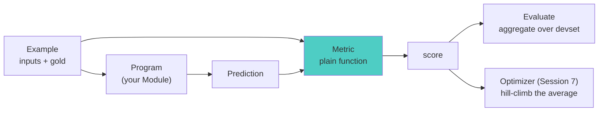
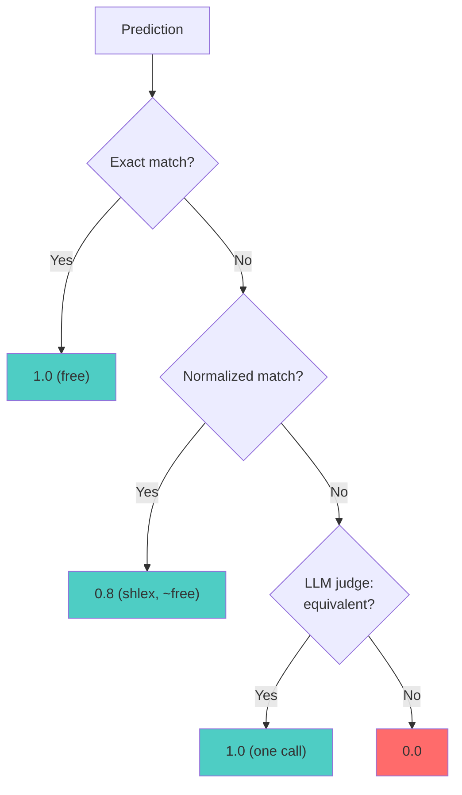

# Session 6: Metrics - Measuring Success
*DSPy Mastery Series - Month 6*

## 1. Opening: The Question Session 5 Left Open

### Where We Are


Welcome back. Today the Core band closes: adapters (Session 4)
translate, modules (Session 5) run, and metrics decide whether what
ran was any *good*.

Session 5 ended on a deliberate loose thread. The `SupportInbox`
program rated the double-charged billing email `high` urgency, and we
shrugged: "whether that is *correct* is Session 6's question." Today
we answer it, and build the machinery that answers it for every
example, every run, automatically.

The stakes are one sentence: **a module you can't score is a module
you can't optimize.** Session 7's optimizers are search procedures,
and a search needs something to maximize. That something is the
metric you write today.

Where the metric sits in the loop:



**Session Goals:**

- Learn the metric contract: `metric(example, pred, trace=None)`, a
  plain function, no base class
- Run `dspy.Evaluate` and read what it returns, especially the failures
- Climb the sline case study's three tiers: exact, normalized, LLM
  judge
- Score Session 5's `SupportInbox` with a composite judge metric, and
  settle the urgency question
- Understand the `trace` argument: one function, two jobs
- Know the built-in metrics shelf, and when to reach for it

## 2. What a Metric Is

**A metric is a plain Python function.** Not a class, not a
decorator, not a registry entry. The whole contract:

```python
def metric(example, pred, trace=None):
    ...
    return score
```

- `example`: a `dspy.Example` from your devset (Session 2), carrying
  the inputs and any gold labels
- `pred`: the `dspy.Prediction` your program returned (Session 5)
- `trace`: `None` most of the time; more in §7
- `score`: `bool`, `int`, `float`, or a `dspy.Prediction` carrying a
  `score` field

The contract is duck-typed. Any function with this shape is a metric,
which means any scoring code you already have (a scikit-learn
scorer, a regex checker, a SQL linter) wraps in one line.

How each return type is read:

| You return | `Evaluate` aggregates it as | Convention |
|---|---|---|
| `bool` | percentage of `True` | pass/fail tasks |
| `int` / `float` | mean | 0.0 to 1.0, higher is better |
| `dspy.Prediction(score=...)` | mean of `.score` | judges that are themselves modules (§8) |

One more reading of the same object, and it is the important one:
**the metric is your spec.** Sessions 2 through 5 told DSPy what the
task looks like (examples), what you want (signatures), and how to
ask (modules). The metric is where you finally write down what
*success* means. Everything downstream, every evaluation number,
every optimizer decision, trusts that definition completely. A vague
metric produces a vaguely-optimized program.

Getting it right on the first try is unlikely, and that is fine: the
official guidance is to start simple and iterate. So we start simple.

## 3. Your First Metric

`code/first-metric.py` scores the `EnglishToUnix` assistant from
Session 5. The devset is Session 2's craft in miniature: gold fields,
inputs marked.

```python
devset = [
    dspy.Example(request=r, command=c).with_inputs("request")
    for r, c in [
        ("print the current working directory", "pwd"),
        ("list files including hidden ones", "ls -la"),
        ("show disk usage of each top-level directory, human readable",
         "du -h --max-depth=1 /"),
        # ... 8 in all
    ]
]
```

The metric is tier 1 of the sline case study, character-for-character:

```python
def exact_command(example, pred, trace=None):
    return example.command.strip() == pred.command.strip()
```

`dspy.Evaluate` is the machine that runs it across the devset:

```python
evaluator = dspy.Evaluate(
    devset=devset,
    metric=exact_command,
    num_threads=4,
    display_progress=True,
)
result = evaluator(program)
```

```
Average Metric: 5 / 8 (62.5%)

--- what Evaluate returns ---
type          : EvaluationResult
result.score  : 62.5   (percentage: 100 * mean of the scores)
len(results)  : 8  (example, prediction, score) triples
```

Three facts about the return value:

- `result` is an `EvaluationResult`, itself a `dspy.Prediction`
  subclass with two fields
- `result.score` is a **percentage** (62.5, not 0.625): 100 times the
  mean of your per-example scores
- `result.results` is the full evidence: a list of `(example,
  prediction, score)` triples, one per devset row

(Version note: older tutorials call `evaluate(...)` and expect a bare
float, or pass `return_outputs=True`. Both are gone in DSPy 3.x;
read `result.score` and `result.results` instead.)

## 4. Reading Failures Before Trusting Numbers

62.5% of *what*, though? Never trust the aggregate before reading the
misses. The triples make that a loop:

```python
for example, prediction, score in result.results:
    if not score:
        ...
```

```
--- the misses, read by hand ---
request  : list files including hidden ones
gold     : ls -la
predicted: ls -a

request  : find all python files under the current directory
gold     : find . -name '*.py'
predicted: find . -type f -name "*.py"

request  : search for TODO in all python files
gold     : grep TODO *.py
predicted: grep -rnw --include=\*.py 'TODO' .
```

Read them. The `find` prediction is *correct*: different quote style,
an extra `-type f` that changes nothing here. The `ls -a` answer
satisfies the request ("list files including hidden ones"), just
without the long format our gold happened to use. The metric is
failing, not the model. **This is the most common first discovery in
evaluation: your metric is too strict.**

`code/evaluate-mechanics.py` shows the knobs that make failure-reading
routine:

| Knob | What it does |
|---|---|
| `display_table=N` | render N result rows as a table (needs pandas; `True` shows all) |
| `save_as_csv=` / `save_as_json=` | persist every row: inputs, gold, prediction, score |
| `failure_score=0.0` | what a *crashed* example scores, instead of aborting |
| `max_errors=` | how many crashes to tolerate before giving up |

```
                               request     example_command        pred_command exact_command
0  print the current working directory                 pwd                 pwd     ✔️ [True]
1     list files including hidden ones              ls -la               ls -a    ✔️ [False]
2             count lines in notes.txt     wc -l notes.txt     wc -l notes.txt     ✔️ [True]
3    show the last 20 lines of app.log  tail -n 20 app.log  tail -n 20 app.log     ✔️ [True]
4      make a directory called backups       mkdir backups       mkdir backups     ✔️ [True]
```

And the daily-driver move, worst cases first:

```python
worst = sorted(result.results, key=lambda triple: triple[2])
```

One war story from preparing this session: with a broken API key,
every example "scored" the `failure_score` of 0.0 and the run
reported a clean-looking 0%. **A wall of zeros can mean crashes, not
bad predictions.** Check the logs (or set `provide_traceback=True`)
before concluding your program is hopeless.

## 5. Climbing the Tiers: The Sline Metric

Our misses are exactly the evaluation challenge the sline case study
hit:

| Challenge | Example from our run |
|---|---|
| Exact match insufficient | `find . -name '*.py'` vs `find . -type f -name "*.py"` |
| Quote variations | `'*.py'` vs `"*.py"` |
| Multiple correct answers | `ls -a` vs `ls -la` (arguably) |
| Functionally different | `grep TODO *.py` vs recursive `grep -rnw ... .` |

Sline's answer is a tiered metric: cheap checks first, an LLM judge
only when they fail.



Tiers 1 and 2 are pure Python (`code/three-tier-metric.py`, adapted
from `case-studies/sline/code/metrics-example.py`):

```python
def normalized_match(expected: str, predicted: str) -> bool:
    try:
        return shlex.split(expected.strip()) == shlex.split(predicted.strip())
    except ValueError:  # unbalanced quotes etc.: fall back to tier 1
        return exact_match(expected, predicted)
```

Tier 3 is where this session earns its place in the series: the
judge is **a DSPy program**, not a prompt string. A signature declares
the judgment; a module runs it.

```python
class CommandsEquivalent(dspy.Signature):
    """Decide whether two Unix commands are functionally equivalent for the
    user's request: would they produce the same effect and output?"""

    request = dspy.InputField(desc="the user's natural language request")
    expected = dspy.InputField(desc="the known-good command")
    predicted = dspy.InputField(desc="the command under evaluation")
    equivalent: bool = dspy.OutputField()

judge = dspy.ChainOfThought(CommandsEquivalent)
```

Everything from Sessions 3 through 5 applies to it: the `bool` output
field is enforced by the adapter, `dspy.inspect_history` shows its
conversations, and (Session 7 spoiler) it can itself be optimized.

The full metric, cheapest tier first:

```python
def command_match(example, pred, trace=None):
    expected, predicted = example.command, pred.command

    if exact_match(expected, predicted):
        score = 1.0
    elif normalized_match(expected, predicted):
        score = 0.8
    else:
        with dspy.context(lm=judge_lm):
            verdict = judge(request=example.request,
                            expected=expected, predicted=predicted)
        score = 1.0 if verdict.equivalent else 0.0

    if trace is not None:          # bootstrapping (Session 7): pass/fail only
        return score >= 0.8
    return score                   # evaluation: partial credit is signal
```

Note `judge_lm`: the task runs on `gpt-4.1-nano`, the judge on
`gpt-4.1-mini`. **Cheap worker, careful grader** is the standard
economy, and `dspy.context(lm=...)` scopes the swap to the judge
call.

Same program, same devset, both metrics:

```
exact only : 62.5
three-tier : 87.5

--- where each miss was rescued (or not) ---
score  1.0  gold: 'ls -la'               predicted: 'ls -a'
score  1.0  gold: "find . -name '*.py'"  predicted: 'find . -type f -name "*.py"'
score  0.0  gold: 'grep TODO *.py'       predicted: "grep -rnw --include=\\*.py 'TODO' ."
```

Read the three verdicts as three lessons:

- `find`: rescued, correctly. This is the tier doing its job.
- `grep`: *not* rescued, correctly. The prediction searches
  recursively from `.`; the gold searches `*.py` in the current
  directory only. Different behavior, and the judge caught it.
- `ls -a`: rescued, *debatably*. It satisfies the request but drops
  the long format the gold used. The judge ruled on "equivalent for
  the user's request" because that is what our signature asked.
  **The judge answers exactly the question you wrote, so write the
  question carefully.** If the long format matters, the signature
  (or the gold's `alternates` list, as sline does) must say so.

## 6. Judging the Unjudgeable: Scoring the SupportInbox

Now the loose thread. `code/judge-metric.py` scores Session 5's
`SupportInbox`, unchanged. Two problems, two techniques:

1. Was `high` urgency *correct*? That needs **gold labels**, which is
   Session 2 work: we decide, and write it down. The double-charge
   email is labeled `high` on purpose (money already lost); a "could
   you add CSV export someday?" email is the low-urgency foil.
2. Is the drafted *reply* any good? No gold reply exists, and no
   string comparison will ever grade courtesy. Rules can't express
   this; a judge can.

The composite metric mixes both, equally weighted:

```python
class AssessReply(dspy.Signature):
    """Assess a support reply along one stated dimension."""

    email: str = dspy.InputField(desc="the customer's email")
    reply: str = dspy.InputField(desc="the support reply under assessment")
    question: str = dspy.InputField(desc="the yes/no dimension to assess")
    verdict: bool = dspy.OutputField()

assess = dspy.Predict(AssessReply)

def inbox_metric(example, pred, trace=None):
    # Rules where rules work: gold labels exist for these.
    category_ok = pred.category == example.category
    urgency_ok = pred.urgency == example.urgency

    # A judge where they don't: no gold reply exists, only properties.
    with dspy.context(lm=judge_lm):
        grounded = assess(email=example.email, reply=pred.reply,
                          question="Does the reply address this customer's specific "
                                   "situation rather than being a generic acknowledgement?").verdict
        actionable = assess(email=example.email, reply=pred.reply,
                            question="Does the reply state a concrete next step or "
                                     "resolution the customer can expect?").verdict

    checks = [category_ok, urgency_ok, grounded, actionable]
    if trace is not None:              # bootstrapping: demos must be clean
        return all(checks)
    return sum(checks) / len(checks)   # evaluation: partial credit
```

One `AssessReply` signature, two questions: the *dimension* is an
input field, so adding a third check is a string, not a new module.
This is the official docs' recommended shape for judging long-form
output: decompose quality into named yes/no properties, ask each
separately, combine in plain Python.

Six labeled emails through the program:

```
overall: 66.67

--- per-example breakdown ---
  1.0     billing/high  got billing/high  | I was charged twice for my March invoice. Please...
  0.5  bug_report/high  got bug_report/high  | URGENT: the export button crashes the app for ou...
 0.75    feedback/low   got feedback/low  | Just wanted to say the new dashboard layout is a...
  0.5    feedback/low   got feedback/low  | Could you add a CSV export option someday? Not b...
  0.5     billing/high  got billing/high  | My card was declined but you still marked the in...
 0.75  bug_report/low   got bug_report/low  | Minor thing: the settings page misspells 'prefer...
```

Two findings, one per column:

- **Session 5's question is answered.** Every category and urgency
  label matches gold, including `billing/high` for the double-charge.
  The model's call was right; what was missing until today was an
  answer key.
- **The replies are where the score leaks.** Most emails lost the
  `grounded` or `actionable` point: the drafts acknowledge politely
  but promise nothing concrete. No label-checking metric would ever
  have seen this. The judge found the program's actual weakness, and
  that weakness (vague replies) is precisely what Session 7's
  optimizers will be pointed at.

### Handle judges with care

An LLM judge is a measurement instrument built from the thing being
measured. Four cautions before you trust one:

- **Noise.** The same reply can get different verdicts across runs.
  Yes/no verdicts on narrow questions are steadier than 1-to-10
  ratings; temperature 0 helps; averaging repeated judgments helps
  more.
- **Cost.** Our little metric makes two judge calls per example:
  a 300-example devset is 600 calls *per evaluation*, and optimizers
  evaluate many candidate programs. Fast paths first (the tier
  pattern), cache-friendly determinism, and sampled subsets keep
  this affordable.
- **Alignment.** Before trusting a judge, score 30 to 50 examples by
  hand and measure agreement between the judge and you, ideally with
  a chance-corrected statistic like Cohen's kappa rather than raw
  percent-agreement. If agreement is poor, tighten the assessment
  question and re-measure.
- **Gameability.** Whatever loophole the judge has, an optimizer will
  find. A judge that rewards length gets padding; a judge that
  rewards apologies gets groveling. This is why alignment checking
  is not optional once optimization enters (Session 7).

And the structural consolation: because `assess` is a `dspy.Predict`,
the judge is inspectable (`dspy.inspect_history`) and *optimizable*.
Its "metric" is agreement with your hand labels. Optimizing the
metric itself sounds circular; it is actually just the same loop one
level up, and it is standard practice.

## 7. The `trace` Argument: One Function, Two Jobs

Every metric we've written carries `trace=None` and then mostly
ignores it. Time to explain the parameter.

DSPy calls your metric in two situations that want different answers:

| Situation | `trace` is | The question being asked | Good answer |
|---|---|---|---|
| Evaluation (`dspy.Evaluate`) | `None` | "how good is this, on average?" | graded float: partial credit is signal |
| Bootstrapping (Session 7) | the recorded LM calls | "is this run clean enough to become a demonstration?" | strict bool: demos teach, and you don't teach from almost-right |

During compilation, optimizers like `BootstrapFewShot` run your
program with tracing on, then ask your metric whether the run's
input/output pairs deserve to become the `demos` that Session 5
showed riding along in the prompt. A demonstration with a subtle
flaw teaches the flaw. Hence the idiom at the bottom of every serious
metric:

```python
    if trace is not None:          # bootstrapping: only clean runs qualify
        return score >= 0.8
    return score                   # evaluation: partial credit is signal
```

`code/trace-pattern.py` calls one metric both ways by hand:

```
--- evaluation mode: trace is None, graded ---
close   : 0.5
perfect : 1.0

--- bootstrap mode: trace passed, strict ---
close   : False
perfect : True
```

What is actually *in* a trace? A list of `(predictor, inputs,
outputs)` triples, one per LM call your program made. The script
turns tracing on manually and looks:

```python
with dspy.context(trace=[]):
    pred = program(request=example.request)
    trace = dspy.settings.trace
```

```
--- inside a real trace ---
predictor : request -> command
inputs    : {'request': 'show the last 20 lines of app.log'}
outputs   : Prediction(
    command='tail -n 20 app.log'
)
```

For a multi-predictor program like `SupportInbox`, the trace holds
one triple per predictor that ran, which means an advanced metric can
check *intermediate* steps (did the triage stage misread the email,
or did the drafting stage fumble a good triage?), not just the final
output. File that thought under Session 7.

## 8. The Built-in Shelf

You will write most metrics yourself, but know what ships in
`dspy.evaluate` (`code/builtin-judges.py`):

| Metric | Kind | What it checks |
|---|---|---|
| `answer_exact_match` | rule | normalized `pred.answer` equals (any) gold answer |
| `answer_passage_match` | rule | any retrieved passage contains the gold answer |
| `normalize_text` | helper | the shared normalizer behind both |
| `EM`, `F1` | rule | token-level exact match / overlap scorers |
| `SemanticF1` | judge | long-form answers: key facts covered, no padding |
| `CompleteAndGrounded` | judge | RAG answers: complete *and* supported by context |

The normalizer explains why the rule-based family is more forgiving
than `==`:

```
--- normalize_text: the shared normalizer ---
'  The Answer!  '  -> 'answer'
'answer'           -> 'answer'
'An ANSWER.'       -> 'answer'
answer_exact_match('Paris'         ) = True
answer_exact_match('  the PARIS. ' ) = True
answer_exact_match('Lyon'          ) = False
```

(Unicode-normalize, lowercase, drop articles, strip punctuation,
collapse whitespace: tier 2 thinking, built in.)

The judges are the interesting ones: **`SemanticF1` is a
`dspy.Module`**, a `ChainOfThought` asking for recall (what fraction
of the gold's key ideas appear?) and precision (what fraction of the
response is on-point?), combined as F1. It expects `question` and
`response` fields on the example and `response` on the prediction:

```python
metric = SemanticF1(decompositional=True)
score = metric(example, pred).score
```

```
SemanticF1 (eval mode)      : 0.667
SemanticF1 (trace mode)     : True  (score >= 0.66?)
```

Look at the trace-mode line, then at the last line of `SemanticF1`'s
own source:

```python
return Prediction(score=score if trace is None else score >= self.threshold)
```

Our §7 idiom, verbatim, in the standard library: graded F1 when
scoring, thresholded pass/fail when bootstrapping. The patterns in
this session are not conventions we invented; they are how DSPy's own
metrics are built.

(That `Prediction(score=...)` return shape has one more trick in it:
a metric can also attach a `feedback` string, natural-language advice
on *why* the score is what it is, that reflective optimizers like
GEPA read verbatim. That is Session 7 material; today, know the
shape exists.)

## 9. Best Practices

### Do

- **Start with the simplest metric that could work.** Exact match, a
  regex, a length check. Get a baseline number the same day, then
  iterate; the metric and the program improve together.
- **Read the misses before trusting the average.** Every number in
  this session changed meaning after reading `result.results`. Sort
  worst-first; save CSVs and diff across runs.
- **Layer costs: rules first, judge last.** The tier pattern gave us
  87.5%-grade fidelity while paying the judge only on the three
  examples that needed it.
- **Give the metric partial credit at eval time, a spine at
  bootstrap time.** The `trace is not None` idiom, everywhere.
- **Validate any judge against hand labels** (30 to 50 examples,
  chance-corrected agreement) before believing it, and re-validate
  after optimization enters.
- **Size the data like Session 2 said.** Even 20 examples beat none;
  30 to 300 each for train and validation is the working range, and a
  held-out test set stays out of the optimizer's reach, always.

### Don't

- **Don't let a too-strict metric slander a good program.** Our
  first number said 62.5%; the program was actually at ~87%. The
  gap was metric error, not model error.
- **Don't let a too-lenient metric flatter one, either.** If
  everything scores 1.0, there is no gradient for Session 7 to climb.
  The `ls -a` rescue shows leniency creeping in through a loosely
  worded judge question.
- **Don't average away a hard constraint.** If a wrong category makes
  the reply worthless, gate it (`return 0.0 if not category_ok`)
  instead of letting three soft points outvote it.
- **Don't ignore judge cost curves.** Judge calls scale as devset ×
  checks × optimizer candidates. Budget before compiling, not after
  the invoice.
- **Don't mistake crashes for zeros.** `failure_score` keeps runs
  alive; it also makes a dead API key look like a 0% program. Read
  logs on suspiciously uniform scores.
- **Don't chase a number you haven't re-read recently.** Metrics
  drift out of sync with what you actually want; re-read a few
  scored examples every time the score jumps.

## 10. Session Wrap & Next Steps

### Key Takeaways

1. **A metric is a plain function:** `metric(example, pred,
   trace=None)` returning bool, float, or a score-bearing
   `Prediction`. Duck-typed; your spec, executable.
2. **Evaluate runs it; you read it.** `EvaluationResult.score` is the
   headline; `.results` triples are the evidence. The evidence
   overrules the headline.
3. **Climb tiers as rules run out:** exact → normalized → LLM judge,
   cheapest first. A judge is a DSPy program: a signature you must
   word carefully, a module you can inspect and even optimize.
4. **`trace` switches the metric between its two jobs:** graded
   scoring for evaluation, strict gatekeeping for demonstration
   bootstrapping. The standard library's own judges use the idiom.

### Preview of Session 7: Optimization

Everything is finally on the table. Session 5 showed the state slots
a module carries (`demos`, instructions); today built the function
that says which states are better. Session 7 connects them: an
optimizer is a search over state, guided by your metric, and
`compile()` is one line: `optimizer = dspy.MIPROv2(metric=command_match)`.
We'll bootstrap demonstrations (your strict `trace` branch, finally
exercised), rewrite instructions, and watch the vague `SupportInbox`
replies that today's judge flagged get measurably better. Bring the
metric you build in this month's action items; it is the fuel.

### Action Items

1. Run `code/first-metric.py`, then read every miss and classify it:
   model error or metric error?
2. Run `code/three-tier-metric.py`; reword the `CommandsEquivalent`
   docstring to require flag-for-flag strictness and watch the
   `ls -a` verdict flip
3. Write a metric for the module you built after Session 5: rules
   for what rules can reach, one `AssessReply`-style judge question
   for what they can't
4. Hand-label 20 of your own examples, run your judge over them, and
   compute plain agreement; if it disappoints, sharpen the judge's
   question and repeat
5. Read part 5 of the sline `TOUR.md` end-to-end: the three tiers,
   plus the benchmarking harness we didn't cover

---

**Remember:** examples are what the task looks like; signatures are
what you want; modules are how you ask. The metric is what "good"
means, written in Python. Next month, a machine reads that definition
and makes your program live up to it.
