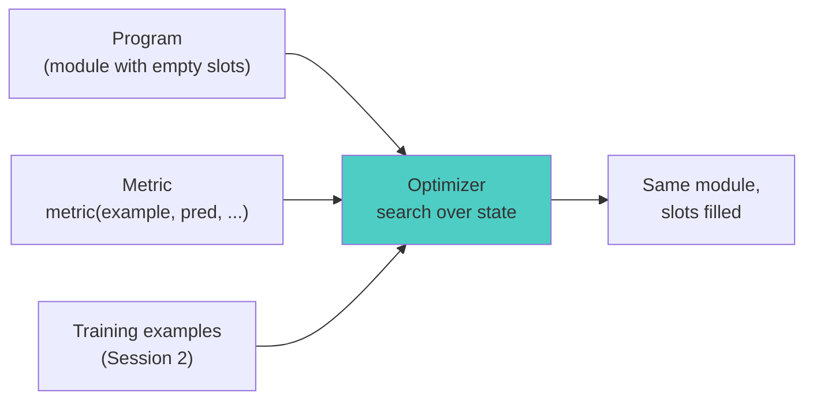
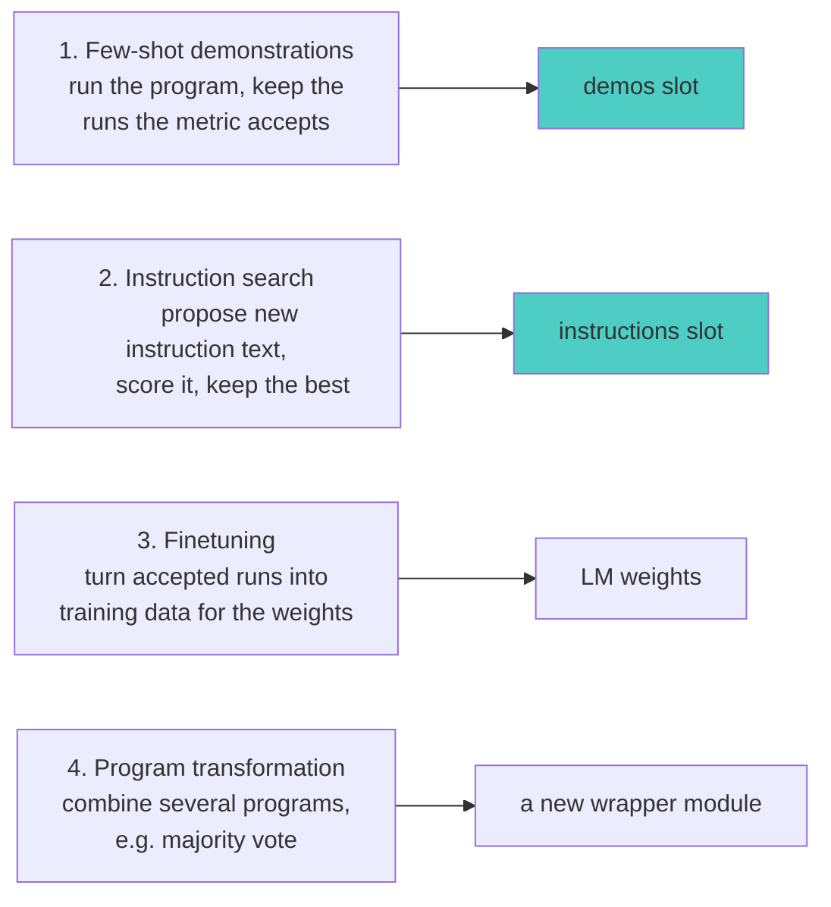
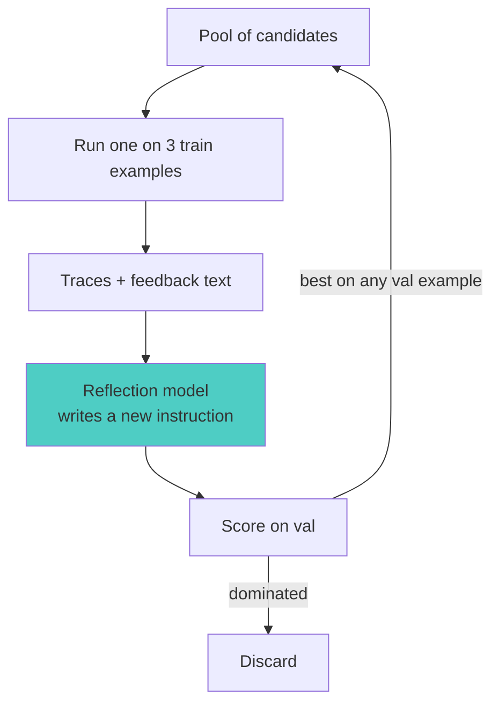

# Session 7: Optimization - The DSPy Superpower
*DSPy Mastery Series - Month 7*

## 1. Opening: Where Optimization Sits

### Where We Are


The Advanced band opens today with its first box, Optimizers. The two
sessions before this one built what an optimizer needs. Session 5
showed that a module carries state in two slots per predictor: `demos`
and the signature's `instructions`. Session 6 built a metric, a plain
function that scores a prediction against an example. An optimizer is
a search over the state slots, and the metric is what it maximizes.



Session 6 ended with two open items. The `SupportInbox` replies were
polite and promised nothing, and the judge metric found that. And the
strict `trace is not None` branch in every metric had never run. Both
are handled today.

**Session Goals:**

- State what an optimizer takes, what it writes, and what `compile()`
  returns
- Run `BootstrapFewShot` and watch the metric's trace branch decide
  which runs become demonstrations
- Run GEPA on both programs with a metric that returns feedback text,
  and read the instructions it writes
- Compare the original and optimized instructions and explain the
  test-set result from the text
- Save an optimized program, load it, and run it under a different
  task model
- Re-check the judge after optimization, and pick an optimizer from
  the shelf by data size and budget

## 2. What an Optimizer Is

The docs define an optimizer as an algorithm that tunes the parameters
of a DSPy program, meaning its prompts and/or its LM weights, to
maximize a metric. A typical optimizer takes three things:

- your **program**, a module with predictors inside
- your **metric**, the Session 6 function
- **training inputs**, which can be small (5 to 10 examples) and can
  lack labels for some optimizers

### Four approaches

Every optimizer in DSPy searches in one of four ways. The first two
change the prompt; the third changes the model; the fourth changes
neither.



| Approach | How it searches | Optimizers | Cost profile |
|---|---|---|---|
| Few-shot demonstrations | run the program on training rows; keep traces the metric accepts as worked examples | `LabeledFewShot`, `BootstrapFewShot`, `BootstrapFewShotWithRandomSearch`, `KNNFewShot` | cheap; one program run per training row, times the number of candidate sets |
| Instruction search | a second LM proposes instruction text; candidates are scored on a valset; the best survive | `COPRO`, `MIPROv2` (also writes demos), `SIMBA`, `GEPA` | a proposer or reflection model plus many metric calls |
| Finetuning | accepted traces become a training set; the LM's weights are updated and the predictor points at the new model | `BootstrapFinetune`, `BetterTogether` | a finetuning job; the result is a smaller, faster model |
| Program transformation | run several programs and combine their outputs | `Ensemble` | multiplies inference cost by the number of members |

Instruction search splits again by how the proposal is made. MIPROv2
and COPRO generate many candidate instructions up front and search
over them, MIPROv2 with Bayesian optimization over instruction and
demo combinations. GEPA and SIMBA generate one candidate at a time by
showing an LM what went wrong on a few examples and asking it to
rewrite the instruction. The second style uses the metric's feedback
text, not just its score, and that is why today's runs use GEPA.

This session covers approach 1 with `BootstrapFewShot` (§4) and
approach 2 with GEPA (§5, §6). Approaches 3 and 4 are on the shelf in
§8.

What each optimizer writes, read from the DSPy 3.3.0 source:

| Optimizer | Writes | Where in the source |
|---|---|---|
| `LabeledFewShot` | `demos`, copied from the trainset | `teleprompt/vanilla.py` |
| `BootstrapFewShot` | `demos`, generated by running the program | `teleprompt/bootstrap.py` |
| `BootstrapFewShotWithRandomSearch` | `demos`, best of several sets on a valset | `teleprompt/random_search.py` |
| `COPRO` | `instructions` | `teleprompt/copro_optimizer.py` |
| `MIPROv2` | `instructions` and `demos` | `teleprompt/mipro_optimizer_v2.py` |
| `GEPA` | `instructions`, one predictor at a time | `teleprompt/gepa/gepa_utils.py` |
| `SIMBA` | `instructions` (as rules) and `demos` | `teleprompt/simba_utils.py` |
| `BootstrapFinetune` | LM weights; sets `predictor.lm` | `teleprompt/bootstrap_finetune.py` |

The `compile()` contract is the same for all of them. It takes a module
and a trainset, sometimes a valset, and returns a module of the same
class with the slots filled. Your `forward()` does not change. Your
signatures' fields do not change. Session 5's save and load roundtrip
works on the result because it is the same architecture.

### Three splits, not two

Session 2 separated `trainset` from `devset`. Optimization needs a
third split:

| Split | Who sees it | Used for |
|---|---|---|
| train | the optimizer | generating demos, reflecting on traces |
| val | the optimizer | choosing between candidate programs |
| test | you, at the end | the number you report |

The optimizer selects on val, so a val score is an optimistic estimate.
The docs' advice for prompt optimizers is to keep val larger than
train; GEPA's docs say the opposite, a large train set and a val set
just big enough. Both agree that a test set the optimizer never touched
is the only number the optimizer did not influence. This session uses 24/12/12 for the Unix
task and 24/6/6 for the inbox.

### Version notes for 3.x

- MIPROv2's interactive confirmation is gone. Passing
  `requires_permission_to_run=True` to `compile()` now raises. Omit it.
- MIPROv2 needs the `optuna` extra: `pip install dspy[optuna]`.
- `dspy.Assert` and `dspy.Suggest` are removed. Session 9 covers the
  replacements.
- The docs moved. The old `learn/optimization` pages redirect to a
  GEPA getting-started page; the original text still lives in the
  repo under `docs/docs/learn/optimization/`.

## 3. Baseline First

Every later number in this deck is a delta against this section.
`code/baseline.py` scores both programs, unoptimized, on their test
splits with the Session 6 metrics. The programs and metrics are
Session 5 and 6 code moved into `code/common.py` without change.

The data:

```
--- data ---
unix   : {'train': 24, 'val': 12, 'test': 12}
emails : {'train': 24, 'val': 6, 'test': 6}
```

The Unix test split holds Session 6's 8 examples plus 4 new ones, so
last month's 87.5 becomes this month's baseline on 12:

```
--- unix baseline (test split, three-tier metric) ---
score : 90.0
   1.0  gold: 'ls -la'                 predicted: 'ls -a'
   0.8  gold: "find . -name '*.py'"    predicted: 'find . -name "*.py"'
   0.0  gold: 'grep TODO *.py'         predicted: "grep -rnw --include='*.py' 'TODO' ."
```

Same three misses as Session 6, same verdicts. The inbox test split is
Session 6's six emails, unchanged:

```
--- inbox baseline (test split, composite judge metric) ---
score : 66.67
    0.5  bug_report/high  got bug_report/high  | URGENT: the export button crashes the app fo...
    0.5     billing/high  got billing/high  | My card was declined but you still marked th...
    1.0     billing/high  got billing/high  | I was charged twice for my March invoice. Pl...
   0.75  bug_report/low   got bug_report/low  | Minor thing: the settings page misspells 'pr...
    0.5    feedback/low   got feedback/low  | Could you add a CSV export option someday? N...
   0.75    feedback/low   got feedback/low  | Just wanted to say the new dashboard layout ...
```

Every label is right. The lost points are all in the reply checks.

The script ends with cost. Each `dspy.LM` keeps a call history with a
`cost` field, and cached calls cost nothing:

```python
def cost(*lms) -> float:
    return sum((entry.get("cost") or 0.0) for lm in lms for entry in lm.history)
```

```
--- cost of this script ---
task model  : $0.0009
judge model : $0.0028
```

Write the cost line into every optimization script. Optimizers call
the metric hundreds of times, and the judge inside the metric is the
expensive part.

### Where the training data came from

The Unix set grew from 28 to 48. Six Session 2 rows that paraphrased
test rows were dropped, and 26 new rows were written for this session.
The email set was harder. Six labeled emails cannot be split. Twenty
billing and bug-report emails were curated from the Tobi-Bueck
customer-support-tickets dataset on Hugging Face (CC-BY-NC-4.0,
English rows, body text kept verbatim). That dataset has almost no
praise or feature requests, so the ten feedback emails were generated
with GPT-5.6 Sol and reviewed by hand. Every category and urgency label
was assigned by hand against a one-line rubric stored in the data
file. `code/data/support-emails.json` records the source of every row.

## 4. The Simplest Optimizer: BootstrapFewShot

`BootstrapFewShot` writes only the `demos` slot. The procedure, from
`teleprompt/bootstrap.py`:

1. For each training example, run the program with tracing on.
2. Call `metric(example, prediction, trace)`.
3. If the metric returns true, every `(inputs, outputs)` pair in the
   trace becomes a demonstration for its predictor.
4. Stop after `max_bootstrapped_demos` successes.

Step 2 is the Session 6 trace branch. `code/bootstrap-fewshot.py`
wraps the metric to record each call:

```python
def watched_metric(example, pred, trace=None):
    verdict = command_match(example, pred, trace)
    verdicts.append((example.request, pred.command, trace is not None, verdict))
    return verdict

optimizer = dspy.BootstrapFewShot(
    metric=watched_metric,
    max_bootstrapped_demos=4,   # demos generated by running the program
    max_labeled_demos=4,        # total demos; trainset rows fill any remainder
)
optimized = optimizer.compile(UnixAssistant(), trainset=trainset)
```

```
--- metric calls during compile ---
trace=yes True  check network connectivity to google.c -> ping -c 4 google.com
trace=yes True  rename report.txt to report-final.txt  -> mv report.txt report-final.txt
trace=yes True  show free memory in human readable uni -> free -h
trace=yes False remove adjacent duplicate lines from l -> awk '!seen[$0]++' list.txt
trace=yes True  delete the file called temp.txt        -> rm temp.txt
5 calls, 4 accepted; stopped once 4 bootstrapped demos were in hand
```

Read the fourth line. The program answered `uniq list.txt` with an
`awk` one-liner. The judge said not equivalent, the metric returned
`False` because a trace was passed, and the run was not kept. That is
what the strict branch is for: a demonstration teaches whatever it
contains, so only clean runs qualify.

The trainset is shuffled with a fixed seed before compile. Without the
shuffle, the first four rows are all trivial and every call passes.

What changed in the module:

```
--- what the optimizer wrote ---
instructions : 'Convert natural language requests into Unix commands.'  (unchanged)
demos        : 4
  [bootstrapped] check network connectivity to google.com -> ping -c 4 google.com
  [bootstrapped] rename report.txt to report-final.txt    -> mv report.txt report-final.txt
  [bootstrapped] show free memory in human readable units -> free -h
  [bootstrapped] delete the file called temp.txt          -> rm temp.txt
```

Two things to notice. The instruction text is untouched, as the §2
table said. And `ping -c 4 google.com` is the model's own output, not
the gold `ping google.com`; the judge accepted it, so the demonstration
carries the model's phrasing. Bootstrapped demos are labeled
`augmented=True` in the state file; demos copied from the trainset are
not.

```
--- test split, before and after ---
baseline     : 90.0
bootstrapped : 98.33
```

One example flipped. On a 12-row test set each row is worth 8.3
points, so treat this as "did not get worse" rather than "gained 8".

### Adding a validation split: random search

`BootstrapFewShotWithRandomSearch` repeats the bootstrap with different
shuffles, scores each candidate demo set on a valset, and returns the
best. Three fixed candidates run first: seed -3 is zero-shot, seed -2
uses labeled demos only, seed -1 is the unshuffled bootstrap.

```python
search = dspy.BootstrapFewShotWithRandomSearch(
    metric=command_match,
    max_bootstrapped_demos=4, max_labeled_demos=4,
    num_candidate_programs=6, num_threads=4,
)
best = search.compile(UnixAssistant(), trainset=trainset, valset=valset)
```

```
seed -2  val  91.67  demos 4
seed  3  val  91.67  demos 4
seed  1  val  86.67  demos 4
seed -1  val  83.33  demos 4
seed  4  val  81.67  demos 4
seed  5  val  81.67  demos 4
seed  2  val  75.00  demos 4
seed  0  val  73.33  demos 4
seed -3  val  71.67  demos 0
best on val  : 91.67
best on test : 81.67
```

The val split is harder than the test split: zero-shot scores 71.67 on
val and 90 on test. The winning candidate, chosen on val, scores 81.67
on test, below the single bootstrap run above. This is the selection
effect from §2. With nine candidates and 12 validation rows, part of
the best val score is noise. The fix is more validation data, not more
candidates.

Cost for the whole script, both optimizers, nine candidate programs:
$0.0059 on the task model.

## 5. GEPA on the Unix Task: Reflective Instruction Search

GEPA writes the `instructions` slot and leaves `demos` empty. Its loop,
from `teleprompt/gepa/gepa.py` and the GEPA paper:

1. Pick a candidate program from the pool.
2. Run it on a small minibatch of training examples (3 by default)
   with tracing on.
3. Give the reflection model the traces and the metric's feedback text,
   and ask it to write a new instruction for one predictor.
4. Score the new candidate on the valset.
5. Keep the candidate if it is the best on at least one val example
   (the Pareto rule), so the pool holds different strengths rather
   than one average winner.
6. Occasionally merge two candidates. Stop at the metric-call budget.



### The metric grows two arguments

GEPA calls the metric with five arguments:

```python
def command_feedback(gold, pred, trace=None, pred_name=None, pred_trace=None):
    score, why = score_command(gold, pred)
    return dspy.Prediction(score=score, feedback=why)
```

`pred_name` is the predictor being reflected on, and `pred_trace` is
that predictor's part of the trace. The return is a `Prediction` with
a `score` and a `feedback` string. GEPA constructs a five-argument
check at init time and raises if the metric's signature does not bind.
A plain float return still works; GEPA then writes "This trajectory
got a score of 0.0" as the feedback, which tells the reflector nothing.

The feedback for the Unix task names the tier that decided:

```
exact match
matches after normalizing quotes/whitespace; gold was "find . -name '*.py'"
judge: equivalent to gold 'ls -la'
not equivalent: gold is 'uniq list.txt', predicted "awk '!seen[$0]++' list.txt"
```

### Two metric contracts

Session 6's idiom and GEPA's contract disagree here. The
Session 6 metric returns a strict bool whenever `trace` is not `None`.
GEPA passes a trace on every call, including the val scoring calls. A
Session 6 metric handed to GEPA would return `True`/`False` for
everything, and the optimizer would lose the graded signal and all the
feedback text.

| Caller | Passes `trace` | Wants back |
|---|---|---|
| `dspy.Evaluate` | never | a graded score |
| `BootstrapFewShot`, `MIPROv2` | during bootstrapping only | a strict bool in that case |
| `GEPA` | always | a graded score plus feedback |

So `code/common.py` keeps both shapes over one scoring function.
`score_command` computes the tier and the sentence; `command_match`
applies the Session 6 idiom for `Evaluate` and the bootstrappers;
`command_feedback` wraps the same result for GEPA.

### The run

```python
optimizer = dspy.GEPA(
    metric=command_feedback,
    auto="light",
    reflection_lm=REFLECTION_LM,   # gpt-5.6-sol, temperature 1.0
    num_threads=6,
    track_stats=True,
)
optimized = optimizer.compile(program, trainset=trainset, valset=valset)
```

`reflection_lm` is required. The docs say to make it strong and not
worry about its cost, because it is called a few dozen times, not a
few thousand. `auto="light"` sets a budget in metric calls. GEPA logs
it before starting:

```
Running GEPA for approx 428 metric calls of the program.
This amounts to 11.89 full evals on the train+val set.
```

The search log, condensed. Each "new program" line is one accepted
reflection:

```
Iteration 1:  Selected program 0 score: 0.717
Iteration 1:  Valset score for new program: 0.917 -> candidate 1
Iteration 7:  Valset score for new program: 0.800 -> candidate 3
Iteration 15: Valset score for new program: 0.833 -> candidate 4
Iteration 17: Valset score for new program: 0.967 -> candidate 5
...
```

The first reflection took val from 71.7 to 91.7. Later ones are
smaller and some are worse; the Pareto rule keeps a worse-on-average
candidate if it wins some example the others lose.

```
--- search statistics ---
candidates tried   : 15
metric calls       : 429
full val evals     : 15
val score by cand. : [0.717, 0.917, 0.917, 0.8, 0.833, 0.967, 0.9, 0.9, 0.883,
                      0.733, 0.883, 0.967, 0.883, 0.983, 0.983]
best candidate     : #13
```

### The two instructions, side by side

Before, the Session 3 docstring:

```
Convert natural language requests into Unix commands.
```

After, the instruction GEPA wrote (full text, from
`code/state/unix-gepa.json`):

```
You will receive an input containing a `request` field written in natural
language. Convert that request into exactly one simple Unix shell command.

Output rules:
- Output only the command, on a single line.
- Do not output explanations, labels, comments, Markdown, or code fences.
- Select the command solely from the request.
- Use the simplest conventional Unix utility that directly performs the
  requested operation.
- Do not broaden the task or add related diagnostics, information,
  restrictions, pipelines, or extra commands.
- Do not join multiple commands with `;`, `&&`, or similar operators when
  one command satisfies the request.
- Preserve all filenames, directory names, URLs, capitalization, and
  relative or absolute path semantics exactly as written.
- Never invent, infer, or expand paths. For example, "Documents folder"
  means `Documents/`, not `~/Documents/`, unless the home-directory path
  is explicitly requested.
- Add shell quoting only when required for correct parsing. Quoted and
  unquoted simple search terms are semantically equivalent.
- Include conventional options explicitly or implicitly required by the
  wording, such as `-h` for human-readable size or disk-space output.
- Semantically equivalent standard commands are acceptable, but prefer
  the canonical minimal form.
- A clarifying restriction such as `-type f` is acceptable when the
  request explicitly refers to files.

Canonical mappings:
- "show system information" -> `uname -a`
  Do not append commands such as `lsb_release`, `hostname`, `uptime`, or `df`.
- "download the file at URL" -> `curl -O URL`
  `wget URL` is also semantically acceptable.
- "kill the process with id PID" -> `kill PID`
- "show lines in FILE that contain SEARCH" -> `grep SEARCH FILE`
- "show the size/disk usage of FILE in human-readable form" -> `du -h FILE`
- "find files modified within the last 24 hours from the current
  directory" -> `find . -type f -mtime -1`
  `find . -mtime -1` is also acceptable.
- "count words in FILE" -> `wc -w FILE`
- "move FILE into named relative directory DIRECTORY" -> `mv FILE DIRECTORY/`
- "show available disk space in human-readable form" -> `df -h`

Return no text other than the resulting command.
```

Read it in two halves. The "Output rules" half is a fair description
of what the metric rewards: one command, no extras, quoting does not
matter, paths verbatim. Every rule traces to a feedback string the
reflector saw. The `~/Documents/` rule comes from the one training row
where nano expanded a path and the judge said no. The "do not append
`lsb_release`" rule comes from the `uname -a` row.

The "Canonical mappings" half is the training set, restated. Nine of
the 24 training rows appear as request-to-command pairs. GEPA cannot
write demos, so the reflector wrote them into the instruction. A score
does not show this; the text does.

### The test result

```
--- test split, before and after ---
baseline : 90.0
gepa     : 83.33
```

Val went from 71.7 to 98.3 and test went from 90.0 to 83.3. The misses
explain it:

```
baseline misses
   0.8  find all python files      gold="find . -name '*.py'"   pred='find . -name "*.py"'
   0.0  search for TODO            gold='grep TODO *.py'        pred="grep -rnw --include='*.py' 'TODO' ."
gepa misses
   0.0  show disk usage of each    gold='du -h --max-depth=1 /'  pred='du -h --max-depth=1'
   0.0  search for TODO            gold='grep TODO *.py'        pred='grep TODO --include="*.py" -r .'
```

The `find` row was fixed: the new instruction says quoting does not
matter, and the model stopped double-quoting. The `grep` row is still
wrong the same way. The `du` row is new: the request says "each
top-level directory", the gold has `/`, and the rule "never invent,
infer, or expand paths" made the model drop it. The judge ruled the two
commands not equivalent, and it is right, since one walks the root and
the other walks the current directory.

So one rule the reflector wrote to fix a training row broke a test row.
The overfitting is visible as a sentence in the prompt, not only as a
number. With 24 training rows, one bad generalization costs one
test row, and one test row is 8.3 points.

Cost of the run, three models:

```
cost     : task $0.025  judge $0.058  reflection $0.101
```

The reflection model was called a few dozen times and cost more than
the other two combined, as expected.

## 6. GEPA on SupportInbox: Feedback Per Predictor

`SupportInbox` has three predictors: `triage`, `extract`, and
`draft.predict` (the `Predict` inside the `ChainOfThought`). Session 6
scored it at 66.67 and found every label right and most replies vague.
`code/gepa-inbox.py` points GEPA at that finding.

### Feedback routed by predictor

GEPA reflects on one predictor at a time and passes its name to the
metric as `pred_name`. The score stays the same for every predictor,
because it is the program's score; the feedback text changes:

```python
def inbox_feedback(gold, pred, trace=None, pred_name=None, pred_trace=None):
    checks = score_inbox(gold, pred)          # category, urgency, grounded, actionable
    score = sum(checks.values()) / len(checks)
    ...
    if pred_name == "triage":
        notes = label_notes or ["labels correct"]
    elif pred_name == "draft.predict":
        notes = reply_notes or ["reply passed both judge checks"]
    elif pred_name == "extract":
        notes = ["ticket extraction is not scored by this metric"]
    else:
        notes = (label_notes + reply_notes) or ["all four checks passed"]
    return dspy.Prediction(score=score, feedback="; ".join(notes))
```

The notes are sentences the judge's failures translate to, for
example "the reply promises nothing concrete; it should state a next
step or resolution the customer can expect". Session 6 said the trace
lets a metric check intermediate steps. `pred_name` and `pred_trace`
are how GEPA asks for that, one predictor at a time.

### The run

Same optimizer call as §5, with `inbox_feedback` as the metric. The
budget is bigger because there are three predictors:

```
Running GEPA for approx 1163 metric calls of the program.
This amounts to 38.77 full evals on the train+val set.
```

Each metric call runs the program (three or four LM calls) and the
judge twice. The run took 50 minutes at six threads. The accepted
reflections, condensed:

```
Iteration 1:  Valset score for new program: 0.667
Iteration 8:  Valset score for new program: 0.750
Iteration 11: Valset score for new program: 0.792
Iteration 17: Valset score for new program: 0.833
Iteration 26: Valset score for new program: 0.958
...
```

```
--- search statistics ---
candidates tried   : 32
metric calls       : 1167
val score by cand. : [0.583, 0.667, 0.667, 0.75, 0.792, 0.833, 0.75, 0.958, ...]
best candidate     : #7
```

Val went from 58.3 to 95.8 on six emails.

### The instructions, per predictor

`extract` did not change:

```
[extract] before:
Pull the fields an engineering ticket needs from a bug report.
[extract] after:
Pull the fields an engineering ticket needs from a bug report.
```

Its feedback said "ticket extraction is not scored by this metric",
and no reflection on it produced a candidate that won a val example.
The metric decides what gets optimized, and a predictor the metric
cannot see stays as written.

`triage` grew from one line to a classification guide. The full text is
in `code/state/inbox-gepa.json`; the parts that matter:

```
[triage] before:
Classify an incoming support email.
[triage] after:
Classify each incoming support email by returning exactly two labels:
...
### Category guidance
- `bug_report`: The sender describes software malfunctioning, crashing,
  failing, or behaving incorrectly. This includes suspected compatibility
  problems with third-party products, such as occasional analytics-software
  crashes that might be related to McAfee Elasticsearch.
- `feedback`: The sender suggests a feature or improvement, requests new
  functionality, or shares praise/opinions about the product. ...

### Urgency guidance
- `high`: Use only when the email indicates immediate or severe impact,
  such as a critical outage, blocked operations, major ongoing disruption,
  explicit deadline, or a clear need for immediate action.
- `low`: Use for praise, feature requests, routine suggestions, and
  noncritical issues without explicit time pressure or severe operational
  impact.

Do not infer high urgency merely from the sender's industry, the mention of
crashes, or the involvement of a third-party system. ...
```

Two things to read. There is no `billing` guidance at all; the
reflector wrote rules for the two categories it saw fail on the
training minibatches and never saw a billing failure. And "McAfee
Elasticsearch" is one training email, quoted twice. This is the §5
pattern again: rules for what failed, and training rows restated.

`draft.predict` grew from one line to about 90. Section headings only:

```
[draft.predict] after:
Write a concise, courteous support response tailored to the customer's
exact situation. ...
1. Explicitly reference the customer's details
2. Give a concrete next step
   A concrete next step must describe an observable action. Do not merely
   say the matter will be "passed along," "looked into," "reviewed
   promptly," or "considered for future updates."
3. Tailor the reply by category
4. Avoid unsupported claims
5. Style
```

Rule 2 is the judge's `actionable` question, rewritten as an
instruction, with the exact phrases the baseline replies used listed
as things not to say. The feedback sentence "promises nothing
concrete" became a paragraph. Rule 4, "avoid unsupported claims", is
the reflector's own addition; nothing in the metric asks for it.

### The test result

```
--- test split, before and after ---
baseline : 66.67
gepa     : 79.17
```

Per email, the four checks before and after:

| Email | Gold | Before | After |
|---|---|---|---|
| export button crashes, we ship today | bug_report/high | labels ok, reply 0/2 | labels ok, reply 2/2 |
| card declined, invoice unpaid twice | billing/high | labels ok, reply 0/2 | urgency **low**, reply 2/2 |
| charged twice, refund the duplicate | billing/high | all four | all four |
| settings page misspells preferences | bug_report/low | labels ok, reply 1/2 | category **feedback**, reply 2/2 |
| add a CSV export option someday | feedback/low | labels ok, reply 0/2 | labels ok, reply 1/2 |
| new dashboard layout is a big improvement | feedback/low | labels ok, reply 1/2 | labels ok, reply 0/2 |

The reply checks went from 4 of 12 to 9 of 12. That is the Session 6
finding, fixed. Two labels that were right before are wrong now, and
the new `triage` text explains both. The declined-card email is
`billing`, which the guide does not cover, and nothing in the urgency
rules names money already taken, so it went `low`. The typo email
"suggests an improvement", which the guide files under `feedback`.

The feedback sentences told the reflector what was wrong ("urgency
should be 'high', got 'low'") and not why. The data file's rubric says
why: high when money was taken or blocked, the product is unusable, or
a deadline is stated. That sentence never reached the reflector. The
fix is to put it in the feedback string, which is a one-line change to
`inbox_feedback`, and it is the first action item.

One reply, before and after:

```
email  : URGENT: the export button crashes the app for our whole team, we ship today!
before : [PRIORITY] Hello, thank you for bringing this urgent issue to our attention.
         We understand the impact this bug has on your team and are actively
         investigating the problem. We will update you as soon as a fix is available.
after  : [PRIORITY] Thank you for alerting us about the export button crashing for
         your team during your urgent shipment today. Please send us any crash logs
         or error messages from the recent export attempt so we can include these
         details in a bug report and help diagnose the issue promptly.
```

### Checking the judge

Session 6 said a judge has to be re-validated once an optimizer enters,
because the optimizer will find whatever the judge rewards. The check
here is small. `code/gepa-inbox.py` saved the six test replies before
and after with the judge's verdicts. `code/judge-check.py` compares
them with hand marks on the same two questions, stored in
`code/state/inbox-hand-marks.json` with a two-line rubric.

```
--- claude vs judge ---
...
Could you add a CSV export opt before grounded   False True   <- disagree
Could you add a CSV export opt after  actionable False True   <- disagree
Just wanted to say the new das after  grounded   False True   <- disagree
Just wanted to say the new das after  actionable False True   <- disagree
agreement: 20/24 = 83%

--- reply quality by hand, before -> after (sum of two dimensions, max 12) ---
claude  : 5 -> 12
judge   : 4 -> 9
```

Twenty of 24 verdicts agree. All four disagreements are the judge
saying no where the hand mark says yes, and three of the four are on
the optimized replies. A gamed judge fails the other way: it says yes
to optimized replies a person would reject. The hand marks also say
the replies improved more than the judge credits. The file has a
second marker's column, empty in this build; the script prints
agreement for every marker it finds. Twelve replies is a check, not a
study. The 30-example version is action item 4.

Cost of the run, three models:

```
cost     : task $0.305  judge $0.469  reflection $1.822
```

The reflector was called 31 times and cost the most, because each call
carries several traces and the growing instruction text. Long
instructions cost on both ends: the reflector reads them and the task
model is sent them on every call afterward.

## 7. Reading and Shipping an Optimized Program

Every script above ended with `save()`. `code/inspect-and-ship.py`
starts from the files.

### Reading a saved state

```python
def describe(program):
    for name, pred in program.named_predictors():
        print(f"  {name:14s} demos={len(pred.demos):<2d} "
              f"instructions={pred.signature.instructions[:70]!r}...")
```

```
--- what each saved state holds ---
bootstrap:
  predict        demos=4  instructions='Convert natural language requests into Unix commands.'...
gepa unix:
  predict        demos=0  instructions='You will receive an input containing a `request` field written in natu'...
gepa inbox:
  triage         demos=0  instructions='Classify each incoming support email by returning exactly two labels:\n'...
  extract        demos=0  instructions='Pull the fields an engineering ticket needs from a bug report.'...
  draft.predict  demos=0  instructions='You will receive two inputs:\n\n- `email`: the customer's support email\n'...
```

This is the §2 table, read back from disk: bootstrap wrote demos and
left the instruction; GEPA wrote instructions and left demos empty.
`named_predictors()` is the loop to keep. It works on any module,
optimized or not, and it is how you diff two states.

The file layout is Session 5's, with one addition:

```
--- where it lives in the file ---
top-level keys        : ['predict', 'metadata']
predict keys          : ['traces', 'train', 'demos', 'signature', 'lm']
instructions at       : state['predict']['signature']['instructions']
demos at              : state['predict']['demos']  (0 entries)
dspy version recorded : 3.3.0
```

`metadata.dependency_versions` records the DSPy, Python, and cloudpickle
versions that wrote the file. A mismatch on load logs a warning, not an
error. Loading a `.pkl` or a whole-program directory now needs
`allow_pickle=True`, so old snippets that call `load()` on a pickle
raise in 3.x. Save state as JSON and rebuild the architecture in code.

### The transfer test

Session 0 promised that a program optimized on one model can be run on
another. The saved states are model-independent text, so the test is
one loop: evaluate each program, baseline and optimized, under the task
model it was optimized on and under one it never saw.

```python
for lm_name, lm in [("gpt-4.1-nano (optimized on)", TASK_LM),
                    ("gpt-5.6-luna (never seen)", DEPLOY_LM)]:
    with dspy.context(lm=lm):
        ...
```

```
task model                    unix base  unix gepa  inbox base  inbox gepa
gpt-4.1-nano (optimized on)       90.00      83.33       66.67       79.17
gpt-5.6-luna (never seen)         83.33      83.33       87.50       83.33
```

Read the second row. Luna's baseline on the inbox is 87.5, above
nano's optimized 79.17. Loading the nano-tuned instructions into Luna
lowers it to 83.33, and on the Unix task the instructions change
nothing. The instructions GEPA wrote describe nano's failures: nano
expanded paths, nano appended `lsb_release`, nano wrote replies that
promised nothing. Luna did not have those failures, so rules against
them do not help it, and the rule that hurt nano on the `du` row hurts
Luna the same way.

What transfers is the workflow, not the prompt. The program, the
metric, the three splits, and the scripts are all reusable on Luna
unchanged. Re-running `compile()` with Luna as the task model is the
same cost as the first run. Session 0's claim holds in that form: you
develop the harness once and re-optimize per model.

The held-out discipline, restated with the numbers above: every score
in the "test" columns comes from rows no `compile()` call received.
The val scores that chose these programs were 98.3 and 95.8. The test
scores are 83.3 and 79.2. That gap is the reason for the third split.

## 8. Choosing an Optimizer

The shelf, with the official rule of thumb from the DSPy docs
(`docs/docs/learn/optimization/optimizers.md`):

| Optimizer | Writes | Reach for it when |
|---|---|---|
| `LabeledFewShot` | demos from the trainset | you want a baseline with demos, no LM calls at compile time |
| `BootstrapFewShot` | bootstrapped demos | very few examples, around 10 |
| `BootstrapFewShotWithRandomSearch` | demos, chosen on val | 50 examples or more, and a valset to choose by |
| `KNNFewShot` | demos, picked per query by embedding similarity | inputs cluster and one demo set does not fit all |
| `COPRO` | instructions, coordinate ascent | instruction-only tuning with a small budget |
| `MIPROv2` | instructions and demos, Bayesian search over combinations | 200 examples or more and 40 trials or more; or zero-shot instruction tuning with `max_*_demos=0` |
| `GEPA` | instructions, by reflection on traces and feedback | your metric can say why in words; you want prompts you can read |
| `SIMBA` | rules and demos from high-variance minibatches | mid-sized sets; a second opinion next to MIPROv2 |
| `BootstrapFinetune` | LM weights | you need a small, fast model and can afford a finetuning run |
| `BetterTogether` | prompts then weights, alternating | you are already finetuning |
| `Ensemble` | nothing; wraps several programs | you have candidates and want to vote |

### MIPROv2 and GEPA

Session 6 previewed MIPROv2. It is still the right tool when demos
matter, because GEPA cannot write them. Its three stages: bootstrap
candidate demo sets, propose candidate instructions grounded in a
summary of the data and the program, then run Bayesian optimization
over instruction-by-demo combinations. `auto="light"` means 6
candidates each and a val subsample of 100; `medium` is 12 and 300;
`heavy` is 18 and 1000.

The GEPA paper (arXiv 2507.19457) reports GEPA beating MIPROv2 by more
than 10 points on its benchmarks with far fewer rollouts, and beating
GRPO by 6 points on average with up to 35 times fewer. The mechanism
behind the efficiency is the feedback text: a scalar says how far off a
run was, and a sentence says why. Today's runs are far smaller than the
paper's, and §5 showed the reflector overfitting 24 rows. A reflector
that learns from three examples per step also overfits to them when
the training set is small.

Cost and time figures quoted in the tutorials: an entity-extraction
run at MIPROv2 medium for $0.26; a RAG run for about $1.50 in 20 to 30
minutes; a multi-hop agent run with a GPT-4o teacher for about $5 in 30
minutes. Today's two GEPA runs at `light` cost $2.78 together, $1.92 of it on
the reflection model.

## 9. Best Practices

### Do

- **Score the baseline first.** Every optimization claim is a delta.
  `code/baseline.py` is short, and every later script repeats its
  evaluation call.
- **Keep three splits.** Train and val belong to the optimizer. Test is
  yours, and it stays out of every `compile()` call.
- **Read the prompt it wrote.** The `du` regression in §5 and the
  training rows restated as "canonical mappings" are visible only in
  the text. A score cannot show them.
- **Give GEPA sentences, not scores.** Name the tier that failed, the
  label that was wrong, the check the judge rejected. The reflector
  copies your wording into the instruction, so write feedback you would
  want to read there.
- **Use a strong reflector and a cheap task model.** The reflector ran
  a few dozen times per run and was still the largest cost line, $0.10
  on the Unix task and $1.82 on the inbox. Its calls are few and long;
  the task model's are many and short.
- **Re-check the judge after optimizing.** §6's hand marks are the
  minimum. A 30-example agreement study is the action item.

### Don't

- **Don't select and report on the same split.** The sline case study's
  own example compiles with `valset=trainset`. It works as a demo and
  it is the wrong pattern.
- **Don't read one flipped example as a trend.** On 12 rows, 8.3
  points is one row. Session 2's guidance of 30 to 300 examples per
  split is what makes deltas mean something.
- **Don't hand GEPA a Session 6 metric unchanged.** It passes a trace
  on every call and would get a bare bool back. Keep both shapes over
  one scoring function.
- **Don't expect optimization to fix a strategy problem.** Session 5's
  rule stands: pick the right module first. GEPA rewrote the
  instructions; it cannot add an `extract` step that is missing.
- **Don't skip the cost line.** The inbox metric makes two judge calls
  per example, and the light budget is 1163 metric calls. Know the
  number before `compile()`, not after.

## 10. Session Wrap & Next Steps

### Key Takeaways

1. **An optimizer is a search over module state.** It takes a program, a
   metric, and training examples, and returns the same module with
   `demos` and/or `instructions` filled. `save()` and `load()` from
   Session 5 work on the result unchanged.
2. **Two optimizers, two slots, two metric shapes.** `BootstrapFewShot`
   fills demos through the strict `trace` branch. GEPA writes
   instructions from feedback text through a five-argument metric.
   Keep both shapes over one scoring function.
3. **Read the prompt it wrote.** Both GEPA runs restated training rows
   inside the instruction, and each wrote one rule that broke a test
   row. Val gains of 27 and 37 points became test changes of -6.7 and
   +12.5.
4. **Re-check after optimizing.** The judge agreed with hand marks on 20
   of 24 verdicts, and the disagreements ran against the optimized
   replies, not for them. The transfer test showed the instructions are
   about one model's failures; the workflow is what moves between
   models.

### Preview of Session 8: Advanced Modules

Session 5 covered `Predict`, `ChainOfThought`, `ReAct`, and
self-consistency. Session 8 goes on to retrieval-augmented programs
with `dspy.Retrieve` and a RAG pipeline, code-executing modules
(`ProgramOfThought` and `CodeAct`), tool-using agents wired to MCP
servers, and `dspy.Parallel` with async for throughput. Every one of
them is a module, so every one of them can be optimized with what you
learned today. `Refine` and `BestOfN` wait for Session 9, where they
replace the removed `dspy.Assert`.

### Action Items

1. Run `code/baseline.py`, then `code/bootstrap-fewshot.py`. Read the
   metric-call log and find the rejected trace.
2. Change `seed` in the `dspy.GEPA` call in `code/gepa-unix.py`, rerun,
   and compare the instruction it writes against the one in this deck. Count how many
   training rows it restates.
3. Take the module and metric you built after Sessions 5 and 6, add
   the five-argument feedback variant, and run GEPA at `light`. Report
   baseline, val, and test.
4. Hand-label 30 outputs of your judge, before and after optimization,
   and compute agreement. If it drops after optimization, the judge
   was gamed.
5. Run `BootstrapFewShotWithRandomSearch` and GEPA on the same data and
   compare test scores and cost. Read sline `TOUR.md` parts 6 and 7 for
   the MIPROv2 version of the same workflow.

---

An optimizer searches the state slots of a module for the values that
maximize your metric on your data. The result is a module you can
read, save, and load. Reading it is part of the work.
