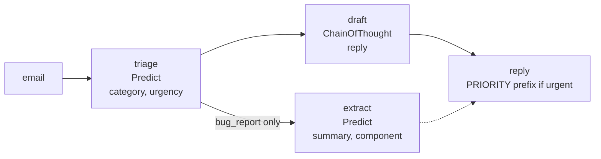
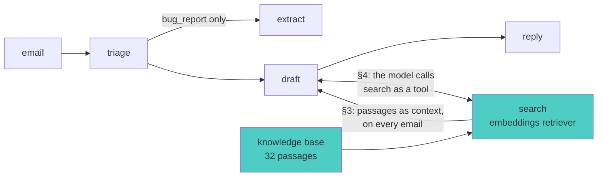
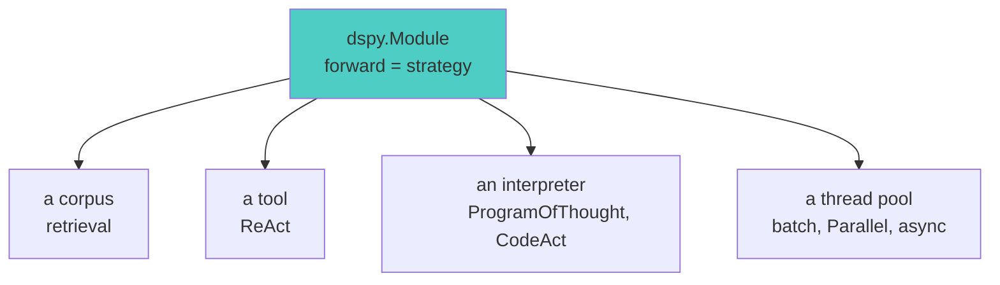

# Session 8: Advanced Modules - Sophisticated Patterns
*DSPy Mastery Series - Month 8*

## 1. Opening: Where Strategy Lives

### Where We Are


We are in the Advanced band, at its second box.

Session 5 gave us a definition. A module is **a strategy plus
state**. The strategy is the code in `forward`. The state is the
`demos` and `instructions` that each predictor carries.

Session 7 showed what an optimizer changes. It changes the state and
nothing else. `compile()` returns the same module with the state
slots filled. Your `forward` does not change.

Session 7 also showed a limit. GEPA improved the `SupportInbox`
replies, but it could not make them concrete. The program had no
facts to put in a reply. A reply cannot name a refund timeline that
the program has never seen. The deck put it this way: an optimizer
cannot add a step that the program does not have.

Today we add the step. We change the strategy, by hand.

### The system so far

The program we build on is `SupportInbox`, written in Session 5 and
carried through Sessions 6 and 7 unchanged. It reads one support
email and produces a reply. Three predictors do the work:



- `triage` labels the email with a category (billing, bug report, or
  feedback) and an urgency (low or high).
- `extract` runs only on bug reports and pulls out a one-line summary
  and the affected component.
- `draft` writes a two-to-three sentence reply. The program prefixes
  it with `[PRIORITY]` when the urgency is high.

Around the program sit the pieces the earlier sessions built:

| Piece | What it is | Session |
|---|---|---|
| state | `demos` and `instructions` on each of the three predictors | 5 |
| data | 36 support emails in train, val, and test splits of 24, 6, and 6 | 7 |
| metric | `inbox_metric`: four checks per email, two on the labels and two on the reply, scored by a judge model | 6 |
| optimizers | `BootstrapFewShot` fills `demos`; GEPA rewrites `instructions` | 7 |

The metric's two reply checks matter most today. A reply is
**grounded** if it addresses the customer's specific situation. It
is **actionable** if it states a concrete next step. After Session 7,
the baseline program passes the actionable check on one email in six.
That is the number we set out to move.

A second program, `UnixAssistant`, turns an English request into a
shell command. It appears only in §7, where we need many cheap calls
to time.

### What we add today

Three of the four additions change the inbox program. The diagram
shows the program with the new parts in color:



| Addition | What changes | Section |
|---|---|---|
| a knowledge base and a retriever | `draft` receives the three passages most like the email | §3 |
| a tool loop | `draft` becomes a `ReAct` agent that decides when to call search | §4 |
| an optimizer run on the agent | `BootstrapFewShot` writes demos into every predictor inside the loop | §5 |
| a code interpreter | `ProgramOfThought` and `CodeAct` run model-written programs on it | §6 |
| threads and async | the same module runs 48 times as a loop, a batch, and on the event loop | §7 |

Each addition is one kind of thing a module's strategy can reach
outside the language model. §2 names the four kinds.

**Session Goals:**

- Name the four things a strategy can reach outside the language
  model, and explain why an optimizer never touches them
- Add retrieval to the inbox program and measure it with Session 7's
  metric and test split
- Let a `ReAct` loop decide when to search, and compare it with
  fixed retrieval on the same six emails
- Bootstrap demonstrations for that agent, and read one
- Run `ProgramOfThought` and `CodeAct` on an interpreter we write
  ourselves
- Run the same 48 calls three ways and read the timing table

## 2. What an Advanced Module Is

The definition does not change. Here is the table from Session 5,
with one new row:

| The module HOLDS (state) | The module DOES (strategy) |
|---|---|
| `demos` per predictor | call predictors in some order |
| `instructions` per signature | branch, loop, run plain Python |
| | **call something that is not a predictor** |

The new row is today's topic. We call each such call a **reach**.
A reach is code in `forward` that talks to something other than the
language model. There are four kinds in this session:

| Reach | What `forward` calls | DSPy module or tool | Section |
|---|---|---|---|
| a corpus | a retriever, which returns passages | `dspy.retrievers.Embeddings` | §3 |
| a tool | a Python function that the model chose | `ReAct` with `dspy.Tool` | §4 |
| an interpreter | `execute(code)`, which returns output | `ProgramOfThought`, `CodeAct` | §6 |
| a thread pool | the same module, many times at once | `batch`, `dspy.Parallel`, `acall` | §7 |



The first two reaches build on the inbox program from Session 7, and
§5 optimizes the result. The last two need different tasks, and the
deck says why when it gets there.

One rule carries the whole session:

**Anything in `forward` that is not a predictor is invisible to
optimizers. You own it.**

Session 5 explained why. `named_predictors()` walks the module's
attributes and collects the predictors. A retriever is an attribute,
but it is not a predictor, so the walk skips it. Here is the
predictor tree of the Session 7 inbox and of today's inbox with
retrieval added:

```
--- the predictor tree, before and after the reach ---
SupportInbox  : ['triage', 'extract', 'draft.predict']
GroundedInbox : ['triage', 'extract', 'draft.predict']
```

The trees are identical. An optimizer will tune the three predictors
and never learn that the retriever exists. The retriever's settings
are yours: how many passages to fetch, which embedding model to use,
and what the corpus contains. You set them by hand, from what you
observe. That division of labor is the point of the session.

## 3. Fixed Retrieval: The Grounded Inbox

### What we do

We give the inbox program a small help center to read from. Before
it drafts a reply, it searches the help center with the email text
and passes the best three passages to the draft predictor. We call
this the **grounded inbox**. The retrieval is "fixed" because it
happens on every email, the same way, with no decision by the model.

### The knowledge base

The help center lives in `code/data/kb.json`. It holds 32 passages
about Planbook, a fictional project management product. The passages
cover refund rules, what to do about a declined card, what counts as
a priority incident, three known bugs, how feature requests are
handled, and support response times.

```
--- the knowledge base ---
32 passages, 8138 characters
```

How the passages were written matters. A strong model (GPT-5.6 Sol)
generated them from a one-page product description and the Session 7
urgency rubric. We then edited them by hand. **The generator never
saw a support email.** That rule keeps the test score honest. A real
help center exists before any ticket arrives. A help center written
to answer the test emails would make the test score meaningless. The
file's `_source` field records all of this, in the same way that
Session 7's data files record their origin.

One consequence: a test email may have no matching passage. That is
a real gap, not a bug in the data. One of the six test emails is in
that situation.

### The retriever

Two objects do the work, both defined in `common.py`:

```python
EMBEDDER = dspy.Embedder("openrouter/openai/text-embedding-3-small")

def retriever(k: int = 3) -> dspy.retrievers.Embeddings:
    return dspy.retrievers.Embeddings(corpus=load_kb(), embedder=EMBEDDER, k=k)
```

An **embedder** turns a text into a vector of numbers. Texts with
similar meaning get similar vectors. `dspy.Embedder` calls the
embedding model through litellm, the same way `dspy.LM` calls a chat
model, so our OpenRouter key works for both. It also accepts any
Python function that maps a list of strings to a matrix, so a local
model is a one-line swap.

A **retriever** finds the passages whose vectors are closest to the
query's vector. `dspy.retrievers.Embeddings` embeds the whole corpus
once, when it is constructed. After that, `search(query)` returns the
top `k` passages by cosine similarity. For a corpus this small it
compares every vector. Above 20,000 passages it builds a FAISS index.

Session 7's preview named `dspy.Retrieve`. That class still exists,
but it depends on a global retriever setting and the current docs do
not use it. `Embeddings` is the current path.

### The program

`GroundedInbox` is `SupportInbox` with one new attribute and one new
input field. The draft signature gains `context`:

```python
class GroundedDraftReply(dspy.Signature):
    """Write a short, courteous reply to a support email. Use the context
    passages for any policy, timeline, or known issue you mention, and do not
    promise anything the context does not support."""

    email: str = dspy.InputField()
    category: str = dspy.InputField()
    context: list[str] = dspy.InputField(desc="passages from the help center")
    reply: str = dspy.OutputField(desc="2-3 sentences")
```

`forward` gains one line, marked below:

```python
class GroundedInbox(dspy.Module):
    def __init__(self, k: int = 3):
        super().__init__()
        self.triage = dspy.Predict(TriageEmail)
        self.extract = dspy.Predict(ExtractTicket)
        self.draft = dspy.ChainOfThought(GroundedDraftReply)
        self.search = retriever(k)   # a plain attribute, not a predictor

    def forward(self, email):
        t = self.triage(email=email)
        ticket = None
        if t.category == "bug_report":
            ticket = self.extract(email=email)
        context = self.search(email).passages          # the new line
        d = self.draft(email=email, category=t.category, context=context)
        ...
```

The email text itself is the search query. The model does not get to
rewrite it. §4 is where the model chooses the query.

### The output

Session 7's hardest email was the export crash. Here is what the
retriever returns for it:

```
--- what retrieval returns for one bug email ---
[1] Scheduled exports are on the Planbook roadmap but are not currently available. Submit the required format, frequency, recipients, and business deadlin...
[2] An incident is priority when it makes Planbook unusable for an entire team, such as preventing all members from opening projects or saving tasks. Emai...
[3] For repeated iOS or Android crashes, update Planbook from the app store, restart the device, and retry the same project or task. If the crash continue...
```

Look at the ranking before you trust it. The top passage is wrong.
The email says "export" and the roadmap passage says "exports" four
times, so the vectors are close, even though one is a crash report
and the other is a feature request. The right passage is second.
Because `k` is 3, the draft predictor saw both, and it used the right
one:

```
--- one email through the grounded inbox ---
category : bug_report
urgency  : high
reply    : [PRIORITY] Thank you for alerting us to this critical issue. Please email support@planbook.example with the subject “Team blocked” and include details about your workspace so our team can assist you as quickly as possible during this urgent situation.
```

### The test result

We score with Session 7's six test emails and Session 7's
`inbox_metric`, both unchanged. The metric has four checks per email.
Two are label checks, `category` and `urgency`. Two are judge checks:
is the reply `grounded` in the customer's situation, and is it
`actionable`, meaning it states a concrete next step. The script
`code/grounded-inbox.py` reports the score and the four checks:

```
--- test split: baseline vs grounded, by check ---
baseline   score  66.7   category 6/6  urgency 6/6  grounded 3/6  actionable 1/6
grounded   score  75.0   category 6/6  urgency 6/6  grounded 3/6  actionable 3/6
```

The claim we set out to test was that `actionable` would rise. It
did, from 1 of 6 to 3 of 6. The label checks did not change, because
the triage predictor did not change. The `grounded` total did not
change either, but it moved underneath. Here is the same result per
email, where `g` is grounded and `a` is actionable:

| Email | Baseline reply | Grounded reply |
|---|---|---|
| export button crashes, we ship today | g=0 a=0 | g=0 **a=1** |
| card declined, invoice unpaid twice | g=0 a=0 | **g=1** a=0 |
| charged twice, refund the duplicate | g=1 a=1 | **g=0** a=1 |
| settings page misspells preferences | g=1 a=0 | g=1 **a=1** |
| add a CSV export option someday | g=0 a=0 | **g=1** a=0 |
| new dashboard layout is a big improvement | g=1 a=0 | **g=0** a=0 |

Three replies gained a check and two lost one. Reading the replies
explains both directions.

The gains come from citing a passage. The crash reply names the
"Team blocked" subject line. The declined-card reply follows the
declined-card procedure. The CSV reply points out that CSV export
already exists.

The losses come from the same mechanism. The refund reply used to
say "we will process a refund." Now it says "please email support
with the charge dates, amounts, and the last four digits of your
card." That sentence comes straight from a passage. The passage is
written for a help center page, where the reader has not contacted
support yet. **This customer is already emailing support.** The
knowledge base speaks in one voice, the reply needs another, and the
draft predictor copied the voice along with the fact.

An optimizer cannot fix that. The problem is in the corpus, and the
corpus is strategy. The fix is to rewrite the passages as facts
instead of instructions, or to tell the draft signature who it is
writing to. Either fix takes an afternoon. Neither is a `compile()`
call.

Compare this with Session 7. GEPA reached 79.2 on these six emails.
It passed 9 of the 12 reply checks, but it broke two labels to get
there. Retrieval reaches 75.0 with 6 of 12 reply checks and every
label intact, with no optimizer and no reflection model. The two
approaches are not rivals. §5 runs an optimizer on a program that
retrieves.

One caution carries over from Session 7. Six emails with four checks
each is 24 checks, so one check is worth 4.2 points. Today's gain of
8.3 points is two checks. Read the replies, not the number.

## 4. Model-Decided Retrieval: The Agentic Inbox

### What we do

In §3 the program searched on every email, using the email as the
query. Now we let the model decide. We call this the **agentic
inbox**. It keeps `triage` and `extract` from §3. It replaces the
draft step with a `ReAct` loop that has one tool, search. The model
decides whether to search, what to search for, and when it has
enough.

### The program

```python
def search_knowledge_base(query: str) -> list[str]:
    """Search Planbook's help center and policy pages. Returns the three
    passages most relevant to the query. Use it to find the refund rule, the
    known issue, or the support commitment that applies to a customer's email."""
    return list(retriever()(query).passages)


class AgenticInbox(dspy.Module):
    def __init__(self, max_iters: int = 4):
        super().__init__()
        self.triage = dspy.Predict(TriageEmail)
        self.extract = dspy.Predict(ExtractTicket)
        self.draft = dspy.ReAct(DraftReply, tools=[search_knowledge_base], max_iters=max_iters)
```

The draft signature is Session 5's `DraftReply`, with no `context`
field. `ReAct` reads the tool's name, type hints, and docstring, as
it did in Session 5. The predictor tree grows by one level, because
`ReAct` holds two predictors of its own:

```
--- the predictor tree ---
['triage', 'extract', 'draft.react', 'draft.extract.predict']
```

### The output

Here is the export crash email going through the loop. A
**trajectory** is the record of each turn: what the model thought,
which tool it called, what arguments it passed, and what came back.

```
--- one bug email through the loop ---
thought_0     : Since the user's email describes a critical bug impacting their team's work and mentions a shipping deadline, ...
tool_name_0   : search_knowledge_base
tool_args_0   : {'query': 'export button crash app'}
observation_0 : ['For repeated iOS or Android crashes, update Planbook from the app store, restart the device, and retry the s...
thought_1     : I have found relevant information indicating that scheduled exports are not currently available and that there...
tool_name_1   : finish
tool_args_1   : {}
observation_1 : Completed.
reply : [PRIORITY] Thank you for reporting this urgent issue. Please contact support@planbook.example with your device details, and we will do our best to assist you promptly given your upcoming shipping deadline.
```

And here is a praise email, which has nothing to look up:

```
--- one feedback email: does it search at all? ---
tool calls : ['finish']
reply      : Thank you for your kind words! We're delighted to hear that you are enjoying the new dashboard layout. Your feedback truly motivates us to keep improving.
```

The model chose not to search. That choice is the whole reason for
the design. Now we measure what the choice costs.

### The test result

Same six emails, same metric. The script `code/agentic-inbox.py`
scores all three inbox programs. It also counts how many language
model calls each program makes per email, and how many searches:

```
--- test split: three programs, same metric ---
baseline   score  66.7   category 6/6  urgency 6/6  grounded 3/6  actionable 1/6
grounded   score  75.0   category 6/6  urgency 6/6  grounded 3/6  actionable 3/6
agentic    score  62.5   category 6/6  urgency 6/6  grounded 2/6  actionable 1/6

program     score  LM calls/email  searches/email
baseline     66.7             2.5             0.0
grounded     75.0             2.5             1.0
agentic      62.5             4.3             0.8
```

The agentic inbox scores below the baseline, and it makes almost
twice as many model calls per email. The searches themselves were
reasonable:

| Email | Query the model wrote |
|---|---|
| export button crashes | `export button crash app` |
| card declined, invoice unpaid twice | `billing policy regarding declined payments and invoice marking` |
| charged twice, refund the duplicate | `refund policy duplicate charges` |
| settings page misspells preferences | `preferences misspelling in settings page` |
| add a CSV export option someday | `CSV export feature request policy or acknowledgment template` |
| new dashboard layout | (no search) |

So the queries are fine, and the retriever is the same one §3 used.
The loss happens after the search. In §3 the passages go straight
into the draft predictor, as a typed `context` field. In the loop,
the passages go into the trajectory as text. The model then writes a
thought about them, and the final predictor writes the reply from
the whole trajectory. Look at `thought_1` above. It says the passages
were about scheduled exports. That is the wrong passage of the three.
The reply was written from that thought. Each extra step between the
fact and the reply is a place where a small model can lose the fact.

Two lessons, with different levels of confidence:

- **Fewer decisions suit a small model.** The grounded inbox gives
  the model no decisions about retrieval. Every decision the loop
  adds is another place for a small model to go wrong. The numbers
  support this.
- **The loop is the right shape when searching is sometimes wrong.**
  The praise email shows it. The loop skipped a search that the
  grounded inbox would have paid for. On six emails that saving is
  one search, and the metric cannot see it. This is a design
  argument, not a measured one.

And a reminder: six emails is a small test. The gap of 12.5 points
is three checks. The last action item asks for a bigger test.

### What about MCP?

Session 7's preview promised agents connected to MCP servers. The
connection is one line per tool. `dspy.Tool.from_mcp_tool(session,
tool)` returns the same `dspy.Tool` that a plain function gives you.
MCP tools are asynchronous, so the agent runs through `acall`, which
§7 explains. The DSPy docs have a worked MCP tutorial. This session
keeps the tool local so that nothing has to be installed.

## 5. Optimizing an Agent

### What we do

Session 5 ended its ReAct section with a claim. ReAct is modules all
the way down, "which is why Session 7's optimizers can tune an agent
like any other program." Nobody in this series had tried it. Now we
do. We run `BootstrapFewShot` on the agentic inbox from §4, using
Session 7's `inbox_metric`, exactly as Session 7 ran it on the Unix
assistant.

### The code

```python
optimizer = dspy.BootstrapFewShot(
    metric=watched_metric,
    max_bootstrapped_demos=2,
    max_labeled_demos=0,
    max_rounds=1,
)
optimized = optimizer.compile(AgenticInbox(max_iters=4), trainset=trainset)
```

`max_labeled_demos` is 0 for a reason. The training rows have labels
for triage, but they have no reply and no trajectory. There is
nothing to copy into the draft predictors by hand, so every demo
must come from running the program.

### The output

A **demo** is a worked example that an optimizer attaches to a
predictor. `BootstrapFewShot` runs the program on a training row,
calls the metric in its strict mode, and keeps the run as a demo only
if the metric says yes. Here the metric says yes only when all four
checks pass:

```
--- metric calls during compile ---
trace=yes False Could you add full keyboard navigation and screen-reader lab
trace=yes False The investment optimization software used by the financial f
trace=yes False I am facing problems with double charges in my billing. Afte
...
trace=yes True  Could you inform me about the payment methods available for 
...
trace=yes True  I am reporting an issue with the SaaS platform where it cras
20 calls, 2 accepted
```

Two runs out of twenty passed all four checks. Session 7 saw the
same selectivity on the Unix task. Here it is stricter, because there
are four gates instead of one.

Those two accepted runs produced demos for every predictor:

```
--- what the optimizer wrote, per predictor ---
triage                 demos=2  chars=[195, 374]
extract                demos=1  chars=[463]
draft.react            demos=2  chars=[1672, 702]
draft.extract.predict  demos=2  chars=[2364, 7014]
```

Look at the sizes. A triage demo is an email and two labels, a few
hundred characters. A demo for the agent's final predictor holds the
email, the category, and the **whole trajectory** that led to the
reply: every thought, every query, and every passage that came back.
One of them is 7,014 characters. From now on, two demos of that size
ride along in every prompt that predictor sends. That is what "a
trajectory becomes a demonstration" means in practice.

Here is one demo for `draft.react`, trimmed:

```
--- one demo for draft.react: a worked trajectory ---
email          : Could you inform me about the payment methods available for the subscription plans? Please share more details if possible.
category       : billing
trajectory     : [[ ## thought_0 ## ]] The customer is requesting information about payment methods for subscription plans, so I should look for relevant details in the support resources related to billing and payment...
next_thought   : The observation provides detailed information about the available payment methods for subscription plans, including credit card options and invoice payments for specific plans. I should synthesize thi...
next_tool_name : finish
next_tool_args : {}
```

It is a worked example of one turn: the turn where the model, having
searched once, decides to finish. The earlier decision to search is
inside the `trajectory` input, not in the demo's outputs.

### The test result

```
--- test split, before and after ---
before     score  62.5   category 6/6  urgency 6/6  grounded 2/6  actionable 1/6
after      score  58.3   category 5/6  urgency 6/6  grounded 1/6  actionable 2/6
```

The score fell by one check. One label broke, one `grounded` check
was lost, and one `actionable` check was gained. On six emails that
is noise, but the direction is not up.

What the run proves, and what it does not:

- **The claim holds.** The optimizer found every predictor inside
  the agent, ran the strict metric, and wrote demos into all four.
  The saved state in `state/agentic-inbox-bootstrap.json` loads into
  a fresh `AgenticInbox` with Session 5's `load`. The loop did not
  get in the way.
- **Two demos are not a training signal.** The two accepted emails
  were a question about payment methods and a sync crash. Neither
  looks like a declined card or a typo report. Session 7's advice of
  30 to 300 examples per split applies, and it applies harder when
  only one run in ten is accepted.
- **The optimizer changed the predictors and nothing else.** The
  retriever still returns 3 passages. The tool is the same function.
  The corpus is the same 32 passages. The §3 problem, the help center
  voice, survived compilation untouched. Those things are strategy.

GEPA is the natural next step, and we do not run it here. Its
feedback text could say "the reply used the wrong passage," and its
reflection model could write an instruction about reading the
observations before finishing. That is Session 7's workflow applied
to today's program. It is the fourth action item.

That closes the inbox story for today. The remaining two reaches, an
interpreter and a thread pool, need different tasks. The inbox has no
arithmetic in it, so code execution has nothing to prove there. And
six emails are too few to time. So §6 borrows a math question from
the DSPy docs and the pizza tools from Session 5, and §7 uses the 48
Unix examples from Session 7.

## 6. Code Execution: ProgramOfThought and CodeAct

### What we do

Some modules ask the model to write a Python program, then run the
program and use its output. We look at two of them. `ProgramOfThought`
writes a program to answer a question. `CodeAct` writes a program
that calls tools. First, though, the program has to run somewhere.
DSPy calls that somewhere an interpreter, and we write one.

### The interpreter

An interpreter is any object with four methods. DSPy defines them as
a Python protocol, `dspy.primitives.CodeInterpreter`:

| Method | What it does |
|---|---|
| `tools` | the host functions that the code may call |
| `start()` | sets up a session |
| `execute(code)` | runs the code and returns its output |
| `shutdown()` | ends the session |

Variables from one `execute()` call are still there in the next, like
cells in a notebook. The output of `execute()` is one of three
things. If the code called `SUBMIT(value)`, the output is that value,
wrapped in `FinalOutput`. Otherwise, if the code ends in a bare
expression, the output is that expression's value. Otherwise the
output is whatever the code printed.

DSPy ships one interpreter, `PythonInterpreter`. It runs the code in
a sandbox (Pyodide inside Deno), so model-written code never touches
your Python process. Deno is a separate install, so this session uses
its own interpreter instead, built on `exec()`. The file is
`code/exec_interpreter.py`, forty lines. Its shape:

```python
class ExecInterpreter:
    def start(self):
        # one dict of variables, with SUBMIT and the tools already in it
        ...

    def execute(self, code, variables=None):
        # run the code with exec() in that dict, with stdout captured
        # if it called SUBMIT(value)       -> return FinalOutput(value)
        # if it ended in a bare expression -> return that value
        # otherwise                        -> return what it printed
        # a failure inside the code        -> raise CodeExecutionError
        ...

    def shutdown(self):
        # drop the dict
        ...
```

The file ends with a self-test that needs no model. Each line below
is one of the cases above:

```
x is 42
43
FinalOutput({'output': {'answer': 42}})
recoverable: ZeroDivisionError: division by zero
timed out: TimeoutError: generated code ran longer than 5s
```

The first line was printed. The second was a bare expression. The
third was a `SUBMIT` call. The fourth is an error the model could
fix. The fifth is the five-second timeout.

One warning. This interpreter runs model-written code in your Python
process, with your permissions. It is here so the session runs
without Deno, and so you can see what an interpreter is. **Real
programs use `PythonInterpreter`.** It plugs into the same modules
through the same constructor argument.

### ProgramOfThought against ChainOfThought

`ProgramOfThought` is three predictors and a loop:

```
--- what ProgramOfThought is made of ---
['code_generate.predict', 'code_regenerate.predict', 'generate_output.predict']
```

The first predictor writes a program. The interpreter runs it. If
the run fails, the second predictor sees the program and the error
and writes a new one. That repeats up to `max_iters` times. Then the
third predictor sees the final program and its output and writes the
answer.

The question comes from the DSPy docs. The script `code/pot-vs-cot.py`
asks `ChainOfThought` and `ProgramOfThought` the same question, on
the same model:

```
--- chain of thought ---
answer : 3710705.040

--- program of thought ---
answer : The value of 12! divided by the sum of the prime numbers between 1 and 30, rounded to three decimal places, is **3713190.698**.

--- the program(s) it wrote: 1 attempt(s) ---
[attempt 1]
    import math
    # Calculate 12!
    factorial_12 = math.factorial(12)
    # List of prime numbers between 1 and 30
    primes = [2, 3, 5, 7, 11, 13, 17, 19, 23, 29]
    sum_primes = sum(primes)
    # Compute the division
    result = factorial_12 / sum_primes
    # Round to three decimal places
    result_rounded = round(result, 3)
    result_rounded

expected : 3713190.698
```

What the output shows:

- Chain of thought is wrong. The model knows the method and gets the
  long division wrong. Reasoning text is not arithmetic.
- Program of thought is exact on the first attempt. Its program ends
  in a bare expression, `result_rounded`, and the interpreter
  returned that value.
- The script creates the interpreter itself and passes it in, as
  `pot(interp, question=...)`, so it can print the program afterward
  from the interpreter's log. The usual way is to pass
  `interpreter_factory=ExecInterpreter` and let the module manage
  one interpreter per call.

### CodeAct: tools inside the program

Session 5's `ReAct` agent called two tools, `room_capacity` and
`pizzas_needed`, one call at a time, as JSON. `CodeAct` gives the
model the same two functions inside the interpreter and asks for a
program. One program can call both.

`CodeAct` puts the tools into the interpreter by sending their source
code. So a tool must be a plain function, and it must import what it
needs inside its own body:

```python
def pizzas_needed(people: int, slices_each: int = 3) -> int:
    """Compute how many 8-slice pizzas feed this many people."""
    import math
    return math.ceil(people * slices_each / 8)
```

The script `code/codeact-pizzas.py` runs ReAct on the task model, and
then CodeAct on the task model and on the larger judge model:

```
--- ReAct, as in Session 5 (gpt-4.1-nano) ---
answer      : 23 pizzas
tool calls  : ['room_capacity', 'pizzas_needed', 'finish']

--- CodeAct (gpt-4.1-nano) ---
answer      : You should order 19 pizzas.
iterations  : 1
first program:
    auditorium_capacity = room_capacity({'room': 'auditorium'})
    expected_attendees = auditorium_capacity / 2
    pizzas = pizzas_needed({'people': int(expected_attendees), 'slices_each': 3})
    print(f"Number of pizzas to order: {pizzas}")
first result : Failed to execute the generated code: AttributeError: 'dict' object has no attribute 'lower'

--- CodeAct (gpt-4.1-mini) ---
answer      : You should order 23 pizzas for the DSPy session in the auditorium.
iterations  : 2
first program:
    room = "auditorium"
    capacity = room_capacity(room=room)
    expected_attendees = capacity // 2
    num_pizzas = pizzas_needed(people=expected_attendees, slices_each=3)
    print(f"Room capacity: {capacity}")
    print(f"Expected attendees (half): {expected_attendees}")
    print(f"Pizzas to order: {num_pizzas}")
first result : "Room capacity: 120\nExpected attendees (half): 60\nPizzas to order: 23\n"
```

What the output shows:

- The small model misread the tool description. The description
  shows the arguments as a schema, `{'room': {'type': 'string'}}`,
  and the model passed that dictionary as the argument. The call
  failed. The model still marked itself finished, and the final
  predictor invented an answer of 19.
- The larger model wrote keyword arguments, got 23 on its first
  program, and spent a second iteration restating the result.
- Session 5's ReAct got 23 on the small model. The JSON tool format
  gives a small model less room to be wrong than free-form code
  does. Choose the module for the model you have.

Both modules are built from ordinary predictors:

```
--- both are modules composed ---
ReAct   : ['react', 'extract.predict']
CodeAct : ['codeact', 'extractor.predict']
```

## 7. Throughput: batch, Parallel, async

### What we do

The last reach is a thread pool or an event loop. We take the Unix
assistant from Session 7, run it over all 48 of its examples three
different ways, and time each way. The script is
`code/throughput.py`.

### The code

```python
def run_loop():
    return [assistant(request=r.request) for r in rows]

def run_batch():
    return assistant.batch(rows, num_threads=8, disable_progress_bar=True)

async def _gather():
    return await asyncio.gather(*(assistant.acall(request=r.request) for r in rows))

def run_async():
    return asyncio.run(_gather())
```

One more line matters more than those three functions:

```python
NO_CACHE_LM = dspy.LM("openrouter/openai/gpt-4.1-nano", max_tokens=400, cache=False)
```

DSPy caches model calls by default. With the cache on, the first
round would pay for 48 completions, and the next two rounds would
read them from disk in milliseconds. The batch and async methods
would then look fast without ever calling the API. Every number
below comes from 48 real completions.

### The output

```
--- 48 requests, three ways, three rounds each ---
method    median s  per call ms  cost/round
loop         46.05          959      0.0011
batch         5.27          110      0.0011
async         1.80           38      0.0011
```

What the table shows:

- **The loop takes about one second per call.** That is the
  provider's response time for a short completion. DSPy adds nothing
  to it.
- **Batch with 8 threads is almost 9 times faster.** It beats 8
  because a slow call no longer holds up the calls behind it.
- **Async is 25 times faster.** All 48 requests are in flight at
  once. The total time is about the slowest single response.
- **The cost column does not change.** Threads and the event loop
  are free. The limit is the provider's rate limit, which 48 requests
  at once did not reach.

### What `batch` is

`Module.batch` pairs the module with each example and hands the
pairs to `dspy.Parallel`. `dspy.Evaluate` runs on the same class
whenever you pass `num_threads`, as every evaluation since Session 6
has. You can call `dspy.Parallel` yourself:

```
--- dspy.Parallel directly: (module, example) pairs ---
print the current working directory          -> pwd
list files including hidden ones             -> ls -a
show disk usage of each top-level directory, -> du -h --max-depth=1 /
count lines in notes.txt                     -> wc -l notes.txt
```

The pairs can use different modules, so two programs can share one
thread pool.

### What `acall` needs

The first run of this script crashed before the table:

```
AttributeError: 'UnixAssistant' object has no attribute 'aforward'. Did you mean: 'forward'?
```

`acall` calls `aforward`. It does not fall back to `forward`. Every
built-in module defines `aforward`. The Unix assistant from Session 5
did not, so we added two lines to it in `common.py`:

```python
    async def aforward(self, request: str) -> dspy.Prediction:
        return await self.predict.acall(request=request)
```

The pattern is mechanical. Write `await` in front of each predictor's
`acall`, and leave plain Python alone. The grounded inbox's
`aforward` awaits its three predictors and calls the retriever
directly, because a similarity search over 32 vectors takes
microseconds and has nothing to wait for:

```
--- a custom module on the async path: GroundedInbox.aforward ---
I was charged twice for my March invoice. Please r -> billing/high: [PRIORITY] Thank you for reaching out. Please email support@planbook.e...
Minor thing: the settings page misspells 'preferen -> bug_report/low: Thank you for bringing the typo in 'preferences' on the settings page ...
```

Two notes. For a module you cannot edit, `dspy.asyncify(module)`
runs its `forward` in a worker thread and gives you something you
can `await`. That is thread speed with an async interface. And when
a tool is itself asynchronous, as every MCP tool is, `ReAct`'s
`aforward` awaits the tool. That is why §4 said MCP agents run
through `acall`.

## 8. The Advanced Shelf

These modules and tools were not demonstrated today. One row each,
with when to reach for it:

| Module or tool | What it does | Reach for it when |
|---|---|---|
| `MultiChainComparison` | reconciles several completions that you pass in | the reasoning is hard enough to justify the extra calls |
| `majority` | votes over completions (Session 5) | a short answer field and cheap samples |
| `KNN` and `KNNFewShot` | picks demos per query by embedding similarity | inputs form clusters and one demo set does not fit all |
| `RLM` | gives the model a REPL over a large input | the input does not fit in a prompt |
| `Flex` | a module whose source code GEPA rewrites | you want the optimizer to change strategy, not only state |
| `ReActV2` | ReAct built on native tool calling; marked experimental | after it leaves experimental |
| `PythonInterpreter` | the Deno sandbox behind today's interpreter contract | any code execution outside a demo |
| `dspy.History` | a typed multi-turn conversation input | a chatbot rather than a one-shot program |
| `dspy.streamify` | streams tokens, with listeners per output field | Session 10 |
| `Refine` and `BestOfN` | sample, score with a reward function, keep the best | Session 9; they replaced `dspy.Assert` |

## 9. Best Practices

### Do

- **Keep non-model work as plain attributes.** Assign a retriever, a
  client, or a cache in `__init__` and call it in `forward`. It will
  not appear in `named_predictors()`, and that is correct.
- **Read the retrieved passages before you read the score.** The top
  passage for the export crash was a roadmap note. Three passages
  saved the reply. One would not have.
- **Write the corpus in the voice the reply needs.** Help center
  pages say "email support." A reply to someone who already did
  should not.
- **Limit what a tool returns.** A search tool returns a few
  passages, not a document. Everything a tool returns goes into the
  next prompt.
- **Turn the cache off before you time anything.** With the cache
  on, the second run proves nothing.
- **Record the strategy settings next to the saved state.** The
  number of passages, the embedder, and the corpus version are not
  in the saved JSON. Put them in the data file's `_source` field or
  in the commit message.

### Don't

- **Don't wrap a retriever in a predictor to make it optimizable.**
  A retriever has no instructions and no demos. It has `k`, and you
  set `k`.
- **Don't use the exec interpreter outside a demo.** It shows the
  contract. It is not a sandbox. `PythonInterpreter` is one argument
  away.
- **Don't give a small model a loop when a line will do.** The
  agentic inbox lost to fixed retrieval on the same passages. Each
  decision is a place for a small model to fail.
- **Don't trust a module's own "finished" flag.** CodeAct on the
  small model declared itself finished after a failed program. Check
  the answer.
- **Don't expect an optimizer to tune a reach.** §5 filled demos. It
  did not change the retriever, the tool, or the corpus. Those change
  when you change them.

## 10. Session Wrap & Next Steps

### Key Takeaways

1. **A strategy can reach outside the language model.** It can call
   a corpus, a tool, an interpreter, or a thread pool. Each reach is
   plain code in `forward`, and no optimizer sees it.
2. **Retrieval fixed what optimization could not.** The inbox went
   from 66.7 to 75.0 with every label intact and no `compile()`. The
   replies that got worse show the corpus's voice leaking through.
3. **More decisions mean more places to fail.** The agentic inbox
   wrote good queries and still lost to fixed retrieval, because the
   small model summarized the passages wrongly before using them.
   Bootstrapping it worked mechanically and did not help.
4. **An interpreter is a four-method contract.** Forty lines meet
   it, and so does a Deno sandbox. Program of thought was exact
   where chain of thought was wrong. CodeAct on a small model
   declared victory after a failed program.

### Preview of Session 9: Assertions

`dspy.Assert` and `dspy.Suggest` are gone from DSPy 3. Two modules
from today's shelf replaced them. `BestOfN` samples N times and keeps
the highest-scoring output. `Refine` samples, critiques, and retries
with the critique in the prompt. Both take a reward function with
the same shape as a Session 6 metric. Session 9 writes reward
functions from the four inbox checks, and asks whether a retry loop
at inference time can do what an optimizer does at compile time, and
at what cost per call.

### Action Items

1. Run `code/grounded-inbox.py`. Read the three passages retrieved
   for every test email in `state/grounded-test-replies.json` and
   count how many top passages are wrong.
2. Rewrite five knowledge base passages as facts instead of
   instructions and run the script again. Report whether the two
   lost `grounded` checks come back.
3. Run `code/agentic-inbox.py` with `JUDGE_LM` as the task model.
   Report whether the loop still loses to fixed retrieval with a
   bigger model.
4. Take Session 7's `inbox_feedback`, add a sentence for the case
   where the reply ignores the retrieved passages, and run GEPA at
   `light` on `AgenticInbox`. Read the instruction it writes for
   `draft.react`.
5. Build a 30-email test split from the Session 7 train and val rows
   and rerun §3, §4, and §5. Six emails cannot settle the questions
   this session asked.

---

A module's strategy is yours. Its state belongs to the optimizer.
Today the strategy reached past the model, into a corpus, a tool, an
interpreter, and a thread pool. Each reach was a line of ordinary
Python. Each one was invisible to `compile()`. And each one changed a
result that no optimizer could have moved.
